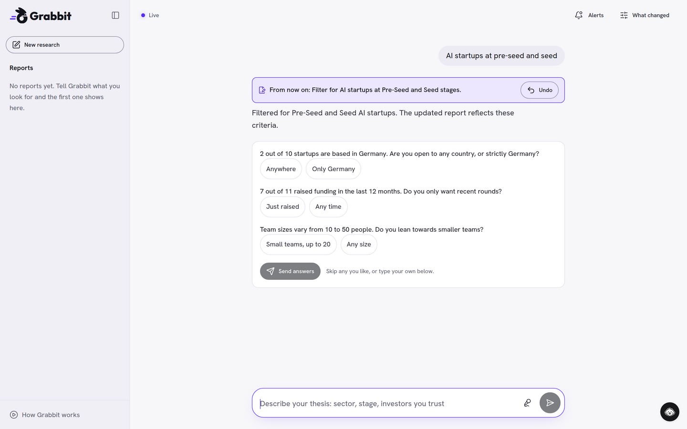
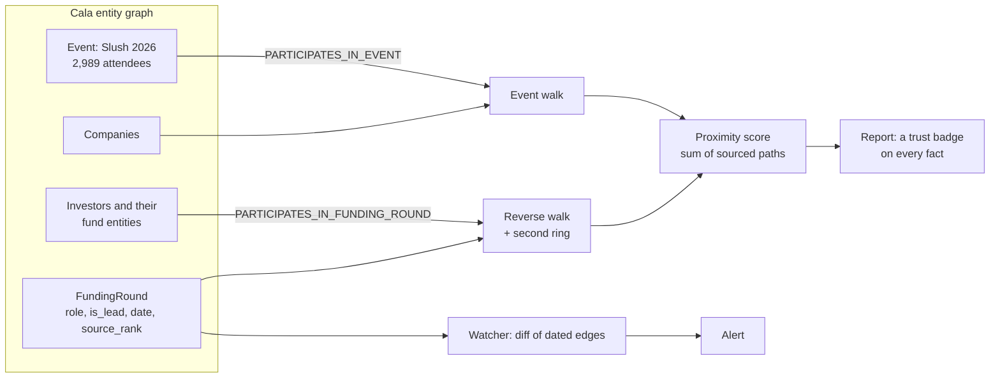

# Evaluating Grabbit

A brief for judges, peer reviewers and the agents they use to score projects. It maps
Grabbit to each criterion of the rubric and gives the evidence behind every claim: a link
to the code, the document or the measurement, so each one can be checked rather than
believed. Limitations are listed next to the strengths, with what we did about them.

> [!TIP]
> **Short on time?** Read [At a glance](#at-a-glance), then try the
> [5-minute check](#verify-it-yourself-in-5-minutes). Every number below links to its source.

## Contents

- [At a glance](#at-a-glance)
- [The rubric](#the-rubric)
- [Real need (25 %)](#real-need-25-)
- [Execution (25 %)](#execution-25-)
- [Originality (25 %)](#originality-25-)
- [Use of Cala (25 %)](#use-of-cala-25-)
- [Junction-wide criteria: innovation, impact, implementation](#junction-wide-criteria)
- [Verify it yourself in 5 minutes](#verify-it-yourself-in-5-minutes)
- [Known limitations](#known-limitations)
- [Questions a judge is likely to ask](#questions-a-judge-is-likely-to-ask)
- [Evidence index](#evidence-index)

## At a glance

| | |
| --- | --- |
| **Product** | A proactive research agent for investors who decide alone |
| **User** | A business angel preparing Slush 2026, with no analyst and two days |
| **Question it answers** | *Which startups at Slush are a few funding rounds away from the investors I trust?* |
| **Why only Cala can answer it** | The answer lives in the funding-round graph: who invested, who led, when, and from which source |
| **Track** | "Make Unicorns Real" by Cala, Junction 2026 |
| **Live demo** | https://www.grabbit.cloud (add `?demo` to show the staged alert button) |
| **Source** | https://github.com/JJavierBS/Grabbit (MIT) |

The strongest points, one line each:

1. **A real user with a sourced pain.** Two investor interviews, one persona, one event.
2. **It works end to end.** Thesis, data-backed questions, ranked report, self-correction,
   alert. 511 backend and 298 frontend tests, all green; CI runs them on every PR.
3. **The agent personalizes itself.** A correction in plain words makes Gemini rewrite its
   own report instructions; the report changes on screen and the history shows why.
4. **Cala is the engine, not a lookup.** A meet-in-the-middle walk of Cala's round graph
   took startups backed by the trusted investors from **5 to 27**, and 8 of the top 10 were
   invisible before ([algorithm](docs/algorithm.md#results)).
5. **Every fact shows how much to trust it.** Cala's `source_rank` becomes a badge on each
   value; a missing field reads "Not published", never zero.

## The rubric

Cala's partner criteria, as published in the track brief
([docs/reference/cala-track-brief.md](docs/reference/cala-track-brief.md)):

| Criterion | Weight | In Cala's words | Where Grabbit answers it |
| --- | --- | --- | --- |
| Real need | 25 % | A clear user with a problem worth solving | [Real need](#real-need-25-) |
| Execution | 25 % | It works smoothly, end to end | [Execution](#execution-25-) |
| Originality | 25 % | A fresh angle, even on a familiar problem | [Originality](#originality-25-) |
| Use of Cala | 25 % | Cala is core to the product, not an add-on | [Use of Cala](#use-of-cala-25-) |

The brief adds: *"Focus beats breadth: one need solved brilliantly wins over many solved
halfway."* At the workshop, Cala asked teams to build on the raw entity endpoints and to
*"uncover insights that might not be so obvious"* from the connected graph. Both shaped the
design below.

---

## Real need (25 %)

> A clear user with a problem worth solving.

### The user

An investor who makes their own decisions and has neither the time nor the means to build
automated research systems: business angels, search funds, small private equity. The demo
follows one of them: **a business angel preparing Slush 2026**
([persona](docs/research/persona-business-angel.md), Spanish).

### The problem, in numbers

- Slush 2026 lists **2,989 attendees** in Cala (2,980 companies). The angel is one person
  with one calendar ([pitch.md](docs/agents/pitch.md#problem-sourced)).
- Preparing by hand means tabs: website, LinkedIn, a funding database, search, news. Five
  per startup is about **15,000 tabs** for the event. Our table demo opens 40 of them for
  just eight startups ([pitch.md](docs/agents/pitch.md#table-setup)).
- Higher up the same segment, a private-equity sourcing process can take three months and
  an external due diligence costs around EUR 150k (Investor B,
  [research.md](docs/agents/research.md)).

### Validated with investors before writing code

On Friday 13 November, before the first commit of product code, we interviewed two
investors (pseudonymised; [minutes](docs/research/acta-2026-11-13.md), Spanish):

| Finding | Quote or evidence | What it changed |
| --- | --- | --- |
| The pain is real at both ends | Investor A: *"I have no time to scout; if a tool pre-selects and I review each pick by hand, I've already won."* Investor B: *"This is a real problem; we have it ourselves and are building it by hand."* | We built for them |
| The AI must not decide | Both want evidence; the investor approves | Grabbit never says what to buy, enforced in code ([rules.py](backend/app/agent/rules.py)) |
| Ask, don't just report | Investor B compared it to "plan mode" in a coding agent | The agent asks 2-3 data-backed questions before it answers |
| Who certifies a number? | Web data is scattered and unverifiable | A trust badge on every fact |
| Sources nobody reads | Investor A: cite them, but inline | The badge sits under each value, not in a footnote list |

The Cala team at the venue asked for **"no dashboard, something active that reaches the
user"** and **one concrete user with one problem**. Grabbit is exactly that: a single flow
for a single persona, which reaches the investor with alerts.

### Why this need is worth solving now

Slush starts the week after Junction. The brief asks for *"a complete product they could
start using the day after the hackathon"*. Grabbit is built for that week: a prep report
before the event, alerts during it, follow-up after it until the angel finds a round
([flow.md](docs/agents/flow.md)).

---

## Execution (25 %)

> It works smoothly, end to end.

### The whole loop runs on real data

| Step | What the user sees | Backed by |
| --- | --- | --- |
| 1. Vague thesis | "AI startups at pre-seed and seed" | Chat, [agent/chat.py](backend/app/agent/chat.py) |
| 2. Live walk | "Walking the Slush attendees in Cala..." with each real step | [agent/progress.py](backend/app/agent/progress.py), Server-Sent Events |
| 3. Questions with numbers | "7 out of 11 raised funding in the last 12 months. Only recent rounds?" | Numbers come from the candidate set, not the model ([agent.md](docs/agents/agent.md)) |
| 4. Trusted investors | "I trust Y Combinator and 500 Global" | Reverse walk + proximity score ([algorithm](docs/algorithm.md)) |
| 5. Report | Ranked shortlist, "Co-invest with investors you trust", a badge under every value, "Why it is here" graph | [reports/](backend/app/reports/) |
| 6. Correction | "Shorter, one line per startup" → "From now on: ..." and the report shrinks on screen | Self-personalization ([agent.md](docs/agents/agent.md)) |
| 7. Alert | "GREÏ announced a Seed, led by Y Combinator", labelled **Simulated event** | Same diff, importance check and delivery as the real watcher ([watcher/](backend/app/watcher/)) |

Timed on the deployed demo on 15 November: thesis to questions 14-21 s, investors to the
open report 31-34 s, correction to the rewritten report 26-37 s
([pitch.md](docs/agents/pitch.md#5-minute-peer-review-at-the-table-draft)).

### Engineering quality

| Signal | Evidence |
| --- | --- |
| Tests | 511 backend tests (pytest) and 298 frontend tests in 51 files (Vitest), all passing on 15 November. Every feature or fix ships with a test ([testing.md](docs/agents/testing.md)) |
| CI | `make test lint` on every PR ([.github/workflows/deploy.yml](.github/workflows/deploy.yml)) |
| Process | 100+ merged PRs, 110+ issues on a public board, one issue = one branch = one PR |
| Typed contract | Pydantic models generate the TypeScript client (`make gen-api`), so the frontend cannot drift from the API |
| Deterministic where it matters | Ranking is a pure function; Gemini writes prose only. It cites values as `{placeholders}` and the server renders them from sourced facts, rejecting any draft that writes its own digits ([decisions.md](docs/agents/decisions.md)) |
| Resilience | Every Cala response cached (SQLite + shared Valkey), `CALA_MODE=replay` for bad wifi, `make warm --check` fails on any cache miss before a demo |
| Rate limits respected | One process-wide queue, spacing between calls, backoff on 429 ([cala/client.py](backend/app/cala/client.py)) |
| Offline fallback | "How Grabbit works" runs the same loop on sample data inside the browser, with no server |
| Deployed | Vercel (frontend) + Aiven Runtime (API) + Aiven for Valkey (shared cache) |

### Craft

Cala said at the workshop that they *"care a lot about craft"*. Details that show it:

- A missing value reads **"Not published"**, never `0` or a guess. A year-precision date
  reads "2019", not "2019-01-01".
- The "From now on: ..." line is composed by the server from the tool call that was really
  applied, so the agent can never claim a change it did not make.
- After a correction the report marks what moved, what is new and what was dropped (struck
  through) for a few seconds, so the change is visible.
- Voice input transcribes live while you speak (Gemini Live API), with the key never in the
  browser.
- Installable as a PWA, works on a phone, light and dark aware, keyboard shortcuts.
- A guided 1-minute tour on sample data for first-time visitors.

---

## Originality (25 %)

> A fresh angle, even on a familiar problem.

Startup databases with saved searches and alerts exist (Harmonic, Specter, Crunchbase,
Dealroom), and so do generic AI chatbots. We do not claim "nothing like it exists". Grabbit
differs in four ways:

### 1. The agent personalizes itself

There is no settings page. Every correction or reaction makes Gemini **rewrite its own
report instructions**. The report regenerates on screen, the reply says what changed in one
line ("From now on: one line per startup."), and "What changed" keeps a history of every
version with the reason and an undo. It also learns from reactions it was not told to act
on ("too long") ([agent.md](docs/agents/agent.md), [agent/learn.py](backend/app/agent/learn.py)).

### 2. It borrows the judgement of investors you trust

Instead of a filter on 2,989 companies, Grabbit starts from the funds the angel already
trusts and walks **their** rounds towards the event: if a fund you respect put money into a
startup, somebody already did the filtering. Second-degree links (a co-investor who often
sits next to your trusted fund) count too, weighted down. The score is a sum of visible
paths, so every rank can be explained ([algorithm](docs/algorithm.md#4-proximity-score-192)).

### 3. Trust is the product

Each fact carries a badge from Cala's `source_rank`: **Official filing, Company or investor,
Press, Database**, plus "Web, unverified" for web signals and "Not published" for absent
fields. A fact with several sources shows the strongest. The ranking also never claims more
trust than its weakest edge ([trust scale](docs/agents/agent.md)).

### 4. It asks before it answers, then it comes to you

A vague thesis gets two or three questions, each with a number from the graph, like plan
mode in a coding agent. After the report, it does not wait to be opened: it watches the
shortlist and sends an alert when something moves.

---

## Use of Cala (25 %)

> Cala is core to the product, not an add-on.

Remove Cala and nothing is left: discovery, ranking, every fact, every badge and every alert
comes from Cala's entity graph.

### What we use, and how deep

| Cala capability | How Grabbit uses it | Where |
| --- | --- | --- |
| Entity search | Find every entity of a trusted fund ("Y Combinator", "Y Combinator W24", ...) | [discovery/reverse.py](backend/app/discovery/reverse.py) |
| Introspection | Ask only about fields that exist for that entity; the product improves as coverage grows | [cala/client.py](backend/app/cala/client.py) |
| Retrieval with edges | Event attendees, rounds with `role` and `is_lead`, issuers, co-investors | [discovery/](backend/app/discovery/) |
| `source_rank` per property and edge | Trust badges and the "source" factor of the score | [cala/normalize.py](backend/app/cala/normalize.py) |
| Date precision | "2019" shown as a year, never invented days | [cala/normalize.py](backend/app/cala/normalize.py) |
| Events as entities | The Slush 2026 attendee list is the starting set | [discovery/pipeline.py](backend/app/discovery/pipeline.py) |
| Dated edges | The watcher diffs rounds, executives, headcount, acquisitions | [watcher/](backend/app/watcher/) |
| Graph walking as agent tools | The chat walks Cala live (`cala_search`, `cala_neighbours`) and draws the path it took | [agent/tools.py](backend/app/agent/tools.py) |
| Knowledge query | Only for "latest news regarding X", as Cala advised; never for discovery | [cala/news.py](backend/app/cala/news.py) |

We followed Cala's own guidance: the raw entity endpoints, not the LLM-processed
`knowledge/*` ones that are being deprecated.

### Insights that are not obvious from one entity

Cala's pitch at the workshop was that connected data *"allows to unveil very unique
insights"*. Grabbit's core is exactly that: a startup's page does not tell you it is two
rounds away from Y Combinator; only walking the graph does.

Measured with Y Combinator and 500 Global as trusted investors
([algorithm, Results](docs/algorithm.md#results)):

| | Reading the event in order | Walking the graph from trust |
| --- | --- | --- |
| Share of Slush reachable | First 150 of 2,989 (5 %) | All 2,989, for anything joined to a trusted investor |
| Startups with a trusted investor in their rounds | 5 | **27** |
| Candidates with any path to a trusted investor | 5 | **45** |
| New Cala calls needed | about 9,000 to read everything | about 520 from a cold cache |
| Top 10 of the ranking | | **8 of 10 were invisible before** |

One in four companies funded by these two investors attends Slush. Of 484 rounds read,
93 % list their funders, 79 % a lead and 94 % a date: the data that makes this possible is
Cala's ([building on Cala](docs/building-on-cala.md)).

### We went deep enough to give Cala useful feedback

We measured Cala as a platform and wrote down what worked, what did not and seven concrete
requests, with numbers: [docs/building-on-cala.md](docs/building-on-cala.md).

---

## Junction-wide criteria

Peer review and the final judges use innovation, impact and implementation.

| Criterion | Grabbit |
| --- | --- |
| **Innovation** | A self-rewriting agent, trust as a first-class value, and a reverse walk from the investors you trust (see [Originality](#originality-25-)) |
| **Impact** | Many angels and small investors decide without a research team. The engine is not tied to Slush: any event in Cala, or a free thesis, works the same way |
| **Implementation** | Deployed, tested, built only on public sourced data through an API, one container plus a cache. Costs and limits are measured and stated, not assumed ([building on Cala](docs/building-on-cala.md)) |

## Verify it yourself in 5 minutes

> [!NOTE]
> The deployed API answers from a cached copy of Cala (`CALA_MODE=replay`) so the demo
> survives venue wifi. The demo pair Y Combinator and 500 Global is warmed; other investors
> may return less.

1. Open https://www.grabbit.cloud/?demo. Close the guided tour card, or press **Show me** for
   the 1-minute tour on sample data.
2. Tap **"AI startups at pre-seed and seed"**. Watch the walk, then read the questions: each
   has a number from the graph.
3. Type **"I trust Y Combinator and 500 Global"**. The report opens with "Co-invest with
   investors you trust".
4. Scroll to a startup. Under each value there is a badge. Open **"Why it is here"** to see
   the path in Cala's graph.
5. Type **"Shorter, one line per startup"**. Read the "From now on" note and watch the report
   shrink. Open **What changed** to see the instructions the agent wrote for itself.
6. Press **Alerts** (top right). Thirty seconds later an alert lands, labelled
   **Simulated event**.

Locally, with no keys at all: set `CALA_MODE=replay` and `LLM_MODE=fake` in `.env`, then
`make setup && make dev` ([README](README.md#run-it-locally)).

## Known limitations

Stated up front, with what we did about each. Full list:
[algorithm, Limitations](docs/algorithm.md#limitations).

| Limitation | What we did |
| --- | --- |
| The demo alert is staged: no startup raises money on cue | It is labelled "Simulated event" on screen and goes through the real diff, importance check and delivery path. The staged change lives in its own fixture, never in the Cala cache |
| Cala has no push or webhooks | The watcher polls the shortlist every 15 minutes and diffs snapshots |
| A cold walk costs hundreds of serial Cala calls | Shared cache, `make warm`, a call budget per turn; the next turn continues from the cache |
| Many fields are sparse (a third of candidates have no stage) | Shown as "Not published"; never counted as zero |
| Late-stage companies can pass the startup rules with a neutral profile | A stage filter in the thesis removes them; the demo thesis uses one |
| Score weights are a first calibration | Named constants; the score is always the sum of the listed paths, never a black box |
| One measurement: two investors, one event, one day | Reproducible with `make warm` ([algorithm](docs/algorithm.md#reproduce-the-numbers)) |

## Questions a judge is likely to ask

**Is the alert real?** No, and the screen says so. The trigger feeds a scripted change into
the same comparison, importance check and delivery that the real watcher uses.

**Why not ask a chatbot?** A chatbot searches the web and writes its own figures. Grabbit
walks the funding rounds from the investors you trust, shows each fact with its source and
its strength, and keeps watching.

**How do you search 2,989 attendees?** Not in list order. It starts from the trusted
investors' rounds and keeps the companies that attend: a meet-in-the-middle search.

**Does it pick for me?** Never. It explains why each startup is on the list; the investor
decides. The rule is enforced in the prompt and by a deterministic guard in code.

**How would it make money?** A subscription per seat or per watched company. No commission
on deals.

## Evidence index

| Topic | Document |
| --- | --- |
| Product overview, run and deploy | [README.md](README.md) |
| How it works, with diagrams | [docs/how-it-works.md](docs/how-it-works.md) |
| Discovery algorithm, measurements, review and data audit | [docs/algorithm.md](docs/algorithm.md) |
| Cala as a platform: strengths, limits, requests | [docs/building-on-cala.md](docs/building-on-cala.md) |
| Same, longer, in Spanish | [docs/research/valoracion-cala.md](docs/research/valoracion-cala.md) |
| User research | [docs/agents/research.md](docs/agents/research.md), [docs/research/](docs/research/) |
| Every design decision, dated | [docs/agents/decisions.md](docs/agents/decisions.md) |
| Demo script and rehearsal | [docs/agents/pitch.md](docs/agents/pitch.md), [docs/demo-rehearsal.md](docs/demo-rehearsal.md) |
| Challenge brief and rubric | [docs/reference/cala-track-brief.md](docs/reference/cala-track-brief.md) |
