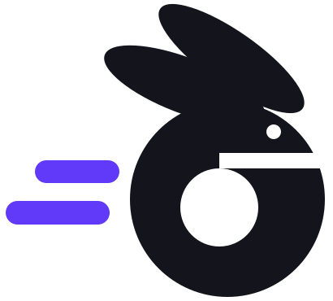
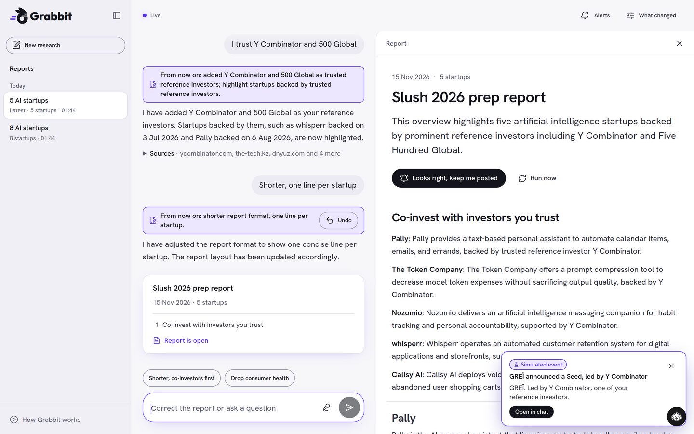
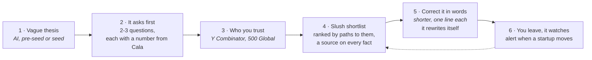
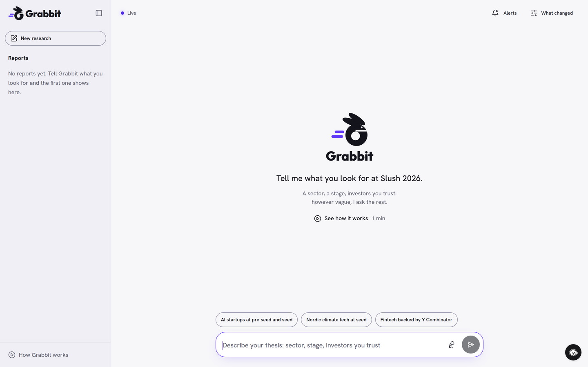
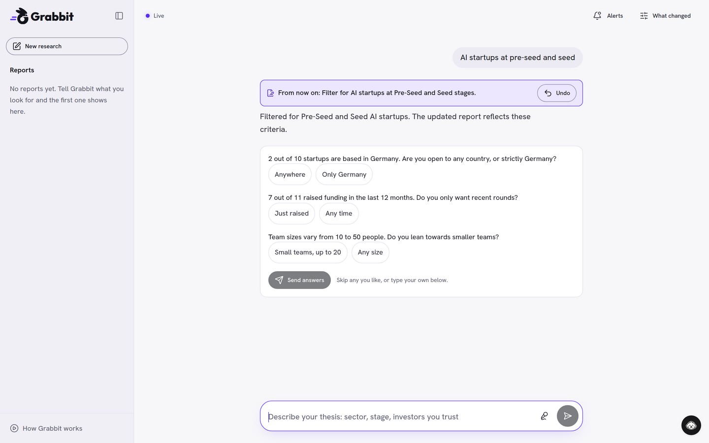
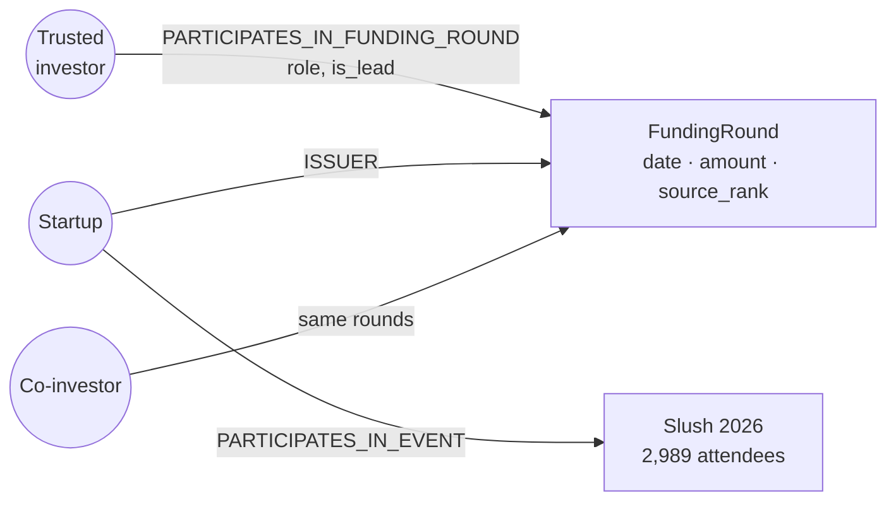
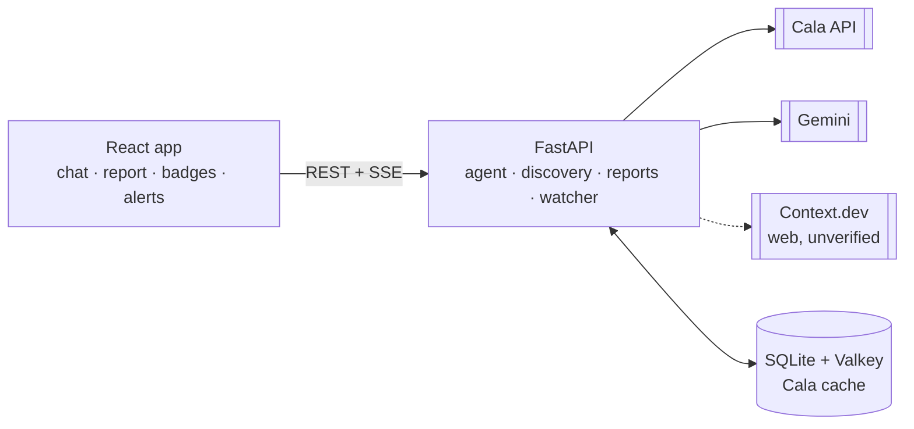

<div align="center">

<picture>
  <source media="(prefers-color-scheme: dark)" srcset="docs/images/grabbit-mark-dark.svg">
  
</picture>

# Grabbit

**Slush has 2,989 attendees and you are one person.**<br>
Grabbit finds the startups backed by the investors you trust, shows the source of every
fact, and alerts you when one of them moves.

[](https://www.grabbit.cloud)
[](https://www.cala.ai)
[](docs/reference/cala-track-brief.md)
[](docs/agents/testing.md)
[](LICENSE)

[Try it](#try-it) · [How it works](docs/how-it-works.md) · [For judges](EVALUATION.md) ·
[Building on Cala](docs/building-on-cala.md) · [Run locally](#run-it-locally)



</div>

> [!NOTE]
> **Judging this project, or asking an agent to?** Start with [EVALUATION.md](EVALUATION.md):
> it maps Grabbit to each criterion of the rubric with the evidence and the limits behind
> every claim. A file index for agents is in [llms.txt](llms.txt).

## The problem

A business angel preparing Slush has one calendar and no analyst. Cala lists 2,989
attendees for Slush 2026. Preparing by hand means tabs: website, LinkedIn, a funding
database, search, news, five per startup, about 15,000 for the event. The angel arrives
tired at the only part that matters: the decision.

The same pain reaches every investor who decides alone and cannot build a research system:
search funds, small private equity, individual investors. Two investor interviews shaped
the product. One of them put it simply:

> *"I have no time to scout; if a tool pre-selects and I review each pick by hand, I've
> already won."* (Investor A, [research](docs/agents/research.md))

## The solution

Grabbit is a proactive research agent, not a dashboard. It borrows the one shortcut
investors really use: **the judgement of people they trust**. If a fund you respect put
money into a startup, somebody already did the filtering.



1. **You give a vague thesis.** "AI startups at pre-seed and seed."
2. **It asks before it answers.** Two or three questions, each with numbers from the
   candidate set: "7 out of 11 raised funding in the last 12 months. Only recent rounds?"
3. **You name who you trust.** Grabbit walks those investors' funding rounds in Cala's graph
   and keeps the startups that attend Slush, plus second-degree links through their usual
   co-investors.
4. **You get a ranked shortlist.** Who led each round and which of your trusted investors
   joined it. Every value carries a badge from Cala's `source_rank`: **Official filing,
   Company or investor, Press, Database**. An absent field reads "Not published", never zero.
   "Why it is here" draws the path in the graph.
5. **You correct it in plain words.** "Shorter, one line per startup." The agent rewrites its
   own report instructions, says so ("From now on: one line per startup."), and the report
   changes on screen. "What changed" keeps the history, with undo.
6. **You leave. It watches.** Every 15 minutes it diffs your shortlist against Cala; when a
   startup raises, loses an executive or grows, a desktop notification tells you what
   changed and why it matters.

Grabbit never tells you what to buy. The investor decides.

| Start vague | It asks, with numbers |
| --- | --- |
|  |  |

## Why Cala is the core

Remove Cala and nothing is left. The question Grabbit answers, *which startups at Slush are
a few funding rounds away from the investors I trust?*, lives only in Cala's funding-round
graph: who invested, who led, when, and from which source.



Reading Slush in list order reaches 150 attendees before the call budget runs out. Walking
from the investors you trust reaches all of them. Measured with Y Combinator and 500 Global
([algorithm](docs/algorithm.md#results)):

| | Event in list order | Walk from trust |
| --- | :---: | :---: |
| Startups with a trusted investor in their rounds | 5 | **27** |
| Candidates with any path to a trusted investor | 5 | **45** |
| Top 10 of the ranking that were invisible before | | **8** |
| Cala calls to get there | about 9,000 (estimate) | about 520 |

Cala features in use: entity search, introspection, retrieval with edges, events as
entities, `source_rank` and date precision on every fact, dated edges for the watcher, and
the graph as agent tools so the chat can walk it live. We built on the raw entity endpoints,
as Cala asked; the LLM knowledge query is used only for news. What worked, what did not and
what we would ask Cala for: [docs/building-on-cala.md](docs/building-on-cala.md).

## Try it

**Live:** https://www.grabbit.cloud (add `?demo` for the button that stages an alert).

1. Tap **"AI startups at pre-seed and seed"** and answer or skip the questions.
2. Type **"I trust Y Combinator and 500 Global"**. The report opens.
3. Scroll to a startup: a badge under every value, and **Why it is here**.
4. Type **"Shorter, one line per startup"** and watch the report rewrite itself.
5. Press **Alerts**: thirty seconds later an alert lands.

> [!NOTE]
> The demo alert is a staged event, labelled **Simulated event** on screen: no startup
> raises money on cue. It still goes through the real diff, importance check and delivery
> path. The deployed API answers from a cached copy of Cala (`CALA_MODE=replay`) so the demo
> survives venue wifi; Y Combinator and 500 Global are the warmed pair.

No server at hand? **How Grabbit works**, at the foot of the sidebar, runs the same loop on
sample data inside the browser.

## How it works



- **Discovery** unites an event walk with a reverse walk from the trusted investors and a
  second ring of their co-investors, then ranks by a **proximity score**: the sum of the
  five strongest sourced paths, weighted by distance, lead or participant, recency, source
  strength and selectivity. Every rank can be explained.
- **The agent** (Gemini) chats, asks data-backed questions, edits the profile and rewrites
  its own instructions through tool calls, under fixed rules enforced in code.
- **Reports** are ranked deterministically; Gemini writes only prose with placeholders and
  the server fills each value from a sourced fact, so the model never invents a number.
- **The watcher** polls the shortlist, diffs snapshots, scores importance and pushes alerts
  over Server-Sent Events.

The full tour, with diagrams of every part: [docs/how-it-works.md](docs/how-it-works.md).
The discovery algorithm, its measurements and its limits: [docs/algorithm.md](docs/algorithm.md).

## Run it locally

You need [uv](https://docs.astral.sh/uv/), Node 24 and npm.

```sh
make setup    # uv sync, npm ci, git hooks; creates .env from .env.example
make dev      # API on :8000, web app on http://localhost:5173
```

> [!TIP]
> **No keys?** Set `CALA_MODE=replay` and `LLM_MODE=fake` in `.env`: the app runs on the
> cache and scripted model answers. With keys, fill `CALA_API_KEY` and `GEMINI_API_KEY`
> (see [.env.example](.env.example)) and run `make warm` once to fill the Cala cache.

| Command | What it does |
| --- | --- |
| `make test` | Backend pytest and frontend Vitest |
| `make lint` | ruff, Biome and the TypeScript check |
| `make fmt` | Formats only the files changed on your branch |
| `make warm` | Fills the Cala cache for the demo; `ARGS=--check` exits 1 on any miss |
| `make gen-api` | Regenerates the TypeScript client from the running API |
| `make docker` | Builds the production image (frontend served by FastAPI on :8000) |

API docs while `make dev` runs: http://localhost:8000/api/docs. Hosting and redeploys:
[docs/deploy.md](docs/deploy.md).

## Built with

| Layer | Technology |
| --- | --- |
| Data | [Cala](https://www.cala.ai) entity API (the core), [Context.dev](https://context.dev) for unverified web signals |
| AI | Gemini via `google-genai`: chat with tool calls, self-rewriting instructions, report prose, importance scores, live voice transcription |
| Backend | Python, FastAPI, uv, Pydantic, APScheduler, SQLite, Server-Sent Events |
| Frontend | React, TypeScript, Vite, OpenUI (generative UI in chat answers), CSS Modules, PWA |
| Infra | Vercel (frontend), Aiven Runtime (API, Docker), Aiven for Valkey (shared Cala cache) |

## Documentation

| If you want to... | Read |
| --- | --- |
| Score the project against the rubric | [EVALUATION.md](EVALUATION.md) |
| Understand the system, with diagrams | [docs/how-it-works.md](docs/how-it-works.md) |
| Dig into the search and ranking | [docs/algorithm.md](docs/algorithm.md) |
| Build on Cala, or read our feedback to Cala | [docs/building-on-cala.md](docs/building-on-cala.md) |
| See the user research | [docs/agents/research.md](docs/agents/research.md), [docs/research/](docs/research/) |
| Check why something was decided | [docs/agents/decisions.md](docs/agents/decisions.md) (dated log) |
| Rehearse or give the demo | [docs/agents/pitch.md](docs/agents/pitch.md), [docs/demo-rehearsal.md](docs/demo-rehearsal.md) |
| Deploy it | [docs/deploy.md](docs/deploy.md) |
| Work on the code | [docs/contributing.md](docs/contributing.md), [AGENTS.md](AGENTS.md) |

## Team

Built in one weekend at Junction 2026, Espoo, by four people each driving AI coding agents
on separate branches, through 100+ reviewed pull requests.

| | Main contributions (from the git history) |
| --- | --- |
| **Francisco Moreno Sánchez** ([@wall3n](https://github.com/wall3n)) | First web app, pitch video, README text |
| **José Javier Bravo Sarabia** ([@JJavierBS](https://github.com/JJavierBS)) | Discovery engine (reverse walk, second ring, proximity score), shared cache, PWA, deploy |
| **Juan López Bravo** ([@juanlo7](https://github.com/juanlo7)) | Product flow and research docs, Cala client and cache, report polish, guided demo, peer review script |
| **Rubén Moyano Palazón** ([@rubmoyanop](https://github.com/rubmoyanop)) | Agent questions and focus, live voice transcription, engine review and data audit, Cala assessment |

<div align="center">

Pitch video: TODO link · Source: MIT, see [LICENSE](LICENSE). Partner APIs and data stay under their own terms.

</div>
