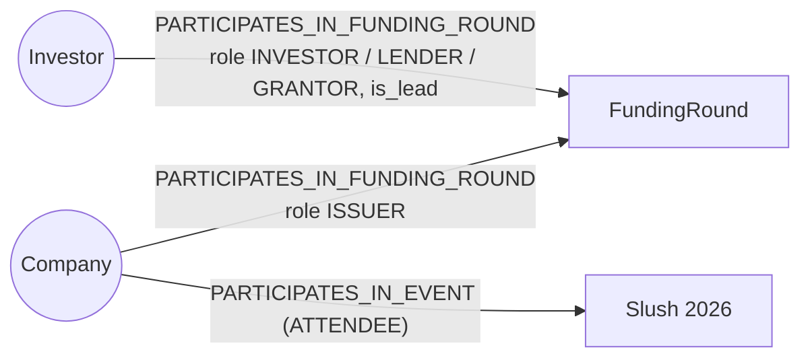
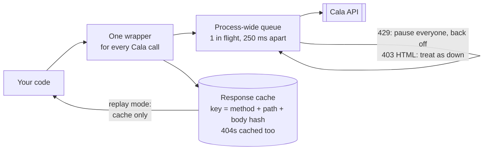
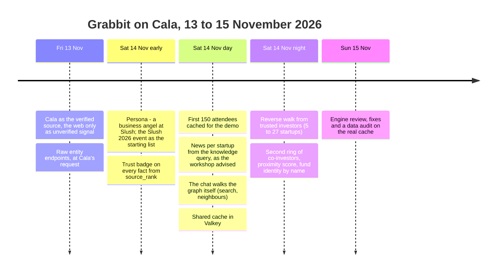

# Building on Cala: what we learned

Written for two readers. **The Cala team**: what your platform made possible for us, where
it got in the way, and what we would ask for, each with a number. **Other teams building
on Cala**: the patterns that saved our demo, so you do not have to rediscover them.

Everything here comes from building Grabbit between 13 and 15 November 2026 at Junction.
Measurements on 15 November were taken on our real cache of Cala responses: 1,145
responses, including 484 funding rounds, 226 companies with properties and the 2,989
attendees of Slush 2026. A longer version in Spanish:
[research/valoracion-cala.md](research/valoracion-cala.md). API notes and quirks, as our
agents use them: [agents/cala.md](agents/cala.md).

## Contents

- [Verdict](#verdict)
- [What we used](#what-we-used)
- [What Cala made possible](#what-cala-made-possible)
- [What got in the way](#what-got-in-the-way)
- [Requests to Cala, by impact](#requests-to-cala-by-impact)
- [Playbook for teams building on Cala](#playbook-for-teams-building-on-cala)
- [How our use of Cala evolved](#how-our-use-of-cala-evolved)

## Verdict

> [!IMPORTANT]
> **As data, Cala is strong. As a platform for a real-time product, it is still young.**
> It is the only source that answers Grabbit's question, *which startups at Slush are a few
> rounds away from the investors I trust?*, and every fact arrives with its source. In
> exchange, the product has to manage caching, call volume and entity identity itself:
> much of our engineering went there rather than into business logic.

| | |
| --- | --- |
| Startups at Slush with a trusted investor in their rounds, found by walking Cala | **27** (5 before the reverse walk) |
| Rounds read with funders listed / with a lead / with a date | **93 % / 79 % / 94 %** of 484 |
| Property sources ranked filing, company or press | **75 %** of 8,033 |
| Cala calls in one first chat turn (mostly from cache) | **898** |
| Calls to read all of Slush node by node (estimate) | **about 9,000** |

## What we used

Four calls carry the whole product.

| Step | Endpoint | What for |
| --- | --- | --- |
| Name to id | `GET /v1/entities?name=` | Find every entity of a trusted fund |
| What a node has | `GET /v1/entities/{id}/introspection` | Ask only for fields and edges that exist |
| Read a node and its neighbours | `POST /v1/entities/{id}` | Event attendees, companies, rounds, investors |
| News (LLM) | `POST /v1/knowledge/query` | Only "latest news regarding X", as Cala advised |

Three node types and one edge type hold the engine:

As Cala asked, we built on the raw entity endpoints, not on `knowledge/search` and
`knowledge/query`, which pass through an LLM, lose information and are being retired.

## What Cala made possible

| Strength | What it let us build | Evidence |
| --- | --- | --- |
| Rounds with participants, `role` and `is_lead` | "Co-invest with who you trust", the proximity score, the lead follow-on signal | Of 484 rounds: 93 % with funders, 79 % with a lead, 94 % with a date, 77 % with an amount; median 2 funders, max 32 |
| `source_rank` and date precision on every fact | Trust badges; "2019" instead of an invented date | 8,033 property sources: 36 % company or investor, 26 % press, 13 % official filing, 13 % aggregator, 11 % unranked, 1 % empty |
| Events as entities | Start from the real 2,989 Slush attendees | 30 pages of 100: 2,980 `Company`, 8 `Organization`, 1 educational institution |
| Introspection per entity | Ask only about fields that exist; the product improves as coverage grows | |
| A graph linked end to end | Reverse walk and second ring with no other source | From 2 funds: 274 rounds, 184 distinct issuers, 42 at Slush, 40 startups; 373 co-investors seen |
| Absent is not zero | "Not published" instead of a false zero | A confirmed zero comes as `0` with a source; an absent field is simply missing |
| Official registries in some countries | Accounts and owners in the UK, income statements in France | |
| API and MCP with the same verbs | The chat walks the graph with two tools, `cala_search` and `cala_neighbours` | |
| An accessible team | Field guide, workshop and answers at the venue | The news use came from the workshop |

The insight only a graph gives: a startup's own page does not say it is two rounds away
from Y Combinator. Walking from the fund does. One in four companies funded by Y Combinator
and 500 Global attends Slush, and 8 of our top 10 were invisible to a walk of the event in
list order.

## What got in the way

### Shape of the API

| Limitation | Evidence | Impact on Grabbit |
| --- | --- | --- |
| No call returns a subgraph or lists entities by criteria | One node per call; no server-side filters or ordering | Filtering, ordering and scoring are all local; a first chat turn makes 898 calls |
| Reading a whole event is not affordable | About 3 calls per attendee (456 for 150), so about 9,000 for Slush; 76 of the first 150 were not startups | The event walk stops at 150 attendees (5 %); we had to invent the reverse walk |
| The investor → round edge has no date | Recency is known only after reading the round | Rounds are read in Cala's order; a cut-short walk may read old ones first |
| No filters on edges | Cannot ask "this fund's rounds since 2024" | Page through everything and discard locally |
| Page size undocumented | `limit: 100` works; max and default unknown | We page 100 at a time |
| No push or webhooks | No change feed | Alerts by polling and snapshot diffs |

### Performance

| Limitation | Evidence | Impact |
| --- | --- | --- |
| Rate limit undocumented, 429 without `Retry-After` | 4 parallel requests trip it; one serial burst tripped it after about 12 calls | One process-wide queue, one request in flight, 250 ms spacing, backoff |
| 403 with an HTML body for minutes | Seen on 14 November around 11:40, even for a single request | Treated as "Cala unavailable", served from cache |
| Very variable latency | Usually under 1 s; introspection 4-11 s; a 15-participant round 12 s; two reads about 7 minutes | 25 s timeout per call; the demo relies on a pre-warmed cache |
| Hub nodes are impractical | An `Industry` node's edges did not answer in 50 s | Never expand industries, countries or events in the chat; skip co-investors with more than 300 round edges |
| News is slow | 29-46 s per call | Only in a scheduled job; reports read the cache |
| Cold volume | About 520 serial reads for two new trusted investors | A budget of 300 new calls per turn; the next turn continues from the cache |

### Data quality and identity

| Limitation | Evidence | Impact |
| --- | --- | --- |
| One real fund is many entities | Y Combinator: 10 search hits (Company, Organization, Group, "Y Combinator W24"...), most with no rounds; 36 entities for YC and 500 Global | A fund identity rule by id or name, used everywhere ([trusted.py](../backend/app/trusted.py)) |
| Duplicate entities | One person as 3 `Person` nodes, Nvidia as 2 companies | Dedupe by normalised name, website and registry id |
| `INVESTED_IN` direction is inconsistent | Mistral AI appeared to invest in its own investors | Ignored; only round participants count |
| `GRANTOR` role undocumented | 70 grantors in 108 rounds, almost all public agencies (Innovate UK 20, Business Finland 11) | Not listed as investors; counts only when the grantor is a trusted fund |
| Founders without history | Of 40 founders and CEOs probed, none linked to another company | "Repeat founder" signal dropped |
| Sparse fields | Of 226 companies: stage 25 %, headcount 17 %, total funding 29 %, founding date 65 %, website 82 %. 54 % of candidates' rounds list no investors | Shown as "Not published"; undated rounds count half |
| Mature companies among attendees | D-ID (Series B), Helion Energy (Series G) pass startup rules | A stage filter in the profile |
| Two round models | `FundingRound` and `PrivateCompanyFundingRound` can repeat one raise | Matched by date and amount before summing |
| Unreliable industries | `AEROSPACE_AND_DEFENSE` on an LLM startup | Not used for "similar companies" |
| Missing ranks | 11 % of property sources and 12 % of round-edge sources unranked; 53 properties with `sources: []` | Treated as aggregator, the weakest level |

## Requests to Cala, by impact

1. **Read several nodes in one call**, or a subgraph to depth 2. A report is hundreds of
   serial calls today.
2. **Dates and filters on edges**: the round date on the investor → round edge, and "since
   a date", so recent rounds are read first.
3. **A canonical fund identity**: one family id grouping a fund's Company, Organization and
   vehicles ("Y Combinator W24").
4. **Fix the direction of `INVESTED_IN`** and document the `GRANTOR` role.
5. **A change feed or webhooks**, for alerts without polling.
6. **More coverage of stage, headcount and round participants** for small startups.
7. **Bounded latency on hub nodes**, or a paginated way to walk them.
8. **A documented rate limit** and a `Retry-After` header on 429.

## Playbook for teams building on Cala

Patterns that worked for us, in the order we would adopt them again.

1. **Put every call behind one wrapper** with a timeout, a shared queue and a cache keyed by
   `(method, path, body)`. Cache 404s too; never cache other errors.
   ([cala/client.py](../backend/app/cala/client.py))
2. **Add a replay mode** that answers only from the cache, and a warm-up script with a
   `--check` that fails on any miss. Run it before every demo.
3. **Share the cache** between your laptop and your deployment (we used Aiven for Valkey),
   so warming once serves everyone.
4. **Introspect, then retrieve only what exists.** Fewer slow reads, and your UI can say
   "Not published" honestly.
5. **Search from the small side.** If your question has a few anchors (trusted funds, a
   company list), walk from them towards the big set and intersect, instead of reading the
   big set. That took us from 5 % of Slush to all of it for the cost of about 520 calls.
6. **Resolve identity yourself.** One real fund or company can be many entities. Match by
   id or by normalised name (strip legal forms only at the end of a name).
7. **Trust round participants, not `INVESTED_IN`.** The round is where role, lead, date and
   sources live.
8. **Never expand hubs** (industries, countries, big events) in an interactive path.
9. **Keep `source_rank` all the way to the screen.** It is Cala's most distinctive value and
   costs nothing to show.
10. **Keep LLM endpoints for colour.** We use `knowledge/query` only for news, in a
    background job, and never let it decide what is a fact.

## How our use of Cala evolved

Each step answered something we learned about Cala.

The turning point was the reverse walk. Before it, Grabbit read attendees in Cala's order
and the angel's trust only labelled the result. After it, trust decides what is read.
Details: [algorithm.md](algorithm.md).
