# How Grabbit works

A visual tour of the system for readers who have not followed the issues: the user flow,
the architecture, how a chat turn walks Cala's graph, how the agent rewrites itself, how
startups are ranked, and how alerts reach the investor. Each section links to the code and
to the longer documents behind it.

> [!NOTE]
> The diagrams are Mermaid and render on GitHub. The numbers come from
> [algorithm.md](algorithm.md), which explains how each one was measured.

## Contents

- [The user's journey](#the-users-journey)
- [Architecture](#architecture)
- [A chat turn, step by step](#a-chat-turn-step-by-step)
- [Discovery: two walks over Cala's graph](#discovery-two-walks-over-calas-graph)
- [Ranking: the proximity score](#ranking-the-proximity-score)
- [Trust: from `source_rank` to a badge](#trust-from-source_rank-to-a-badge)
- [Self-personalization: the agent rewrites itself](#self-personalization-the-agent-rewrites-itself)
- [Proactivity: watcher, digest and alerts](#proactivity-watcher-digest-and-alerts)
- [Guardrails](#guardrails)
- [Data model](#data-model)
- [Where things live](#where-things-live)

## The user's journey

One flow for one persona: a business angel preparing Slush 2026
([flow.md](agents/flow.md)).

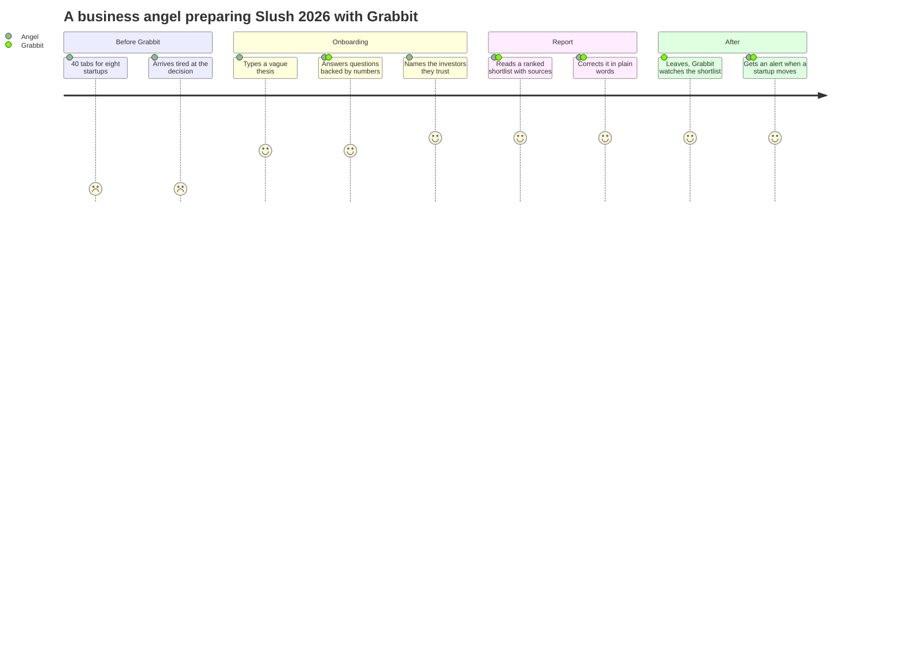

| Screen | |
| --- | --- |
| 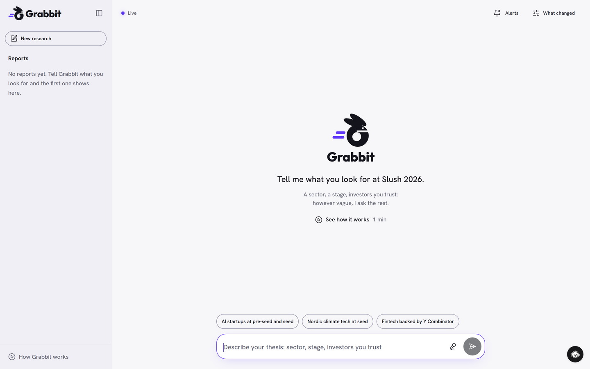 | **Start vague.** One box, one sentence. Suggestions for a first try. |
| 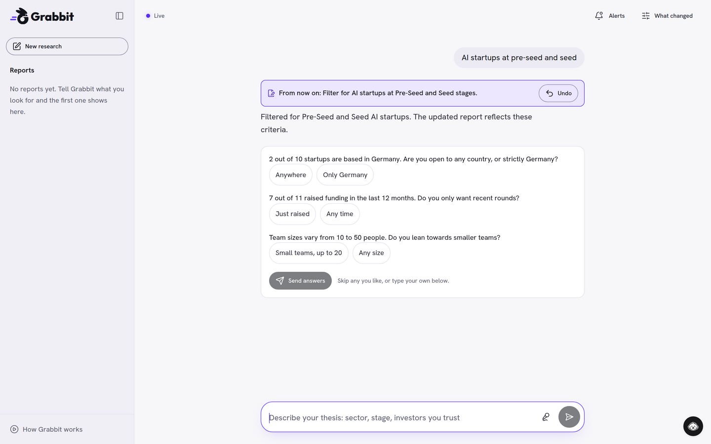 | **It asks before it answers.** Each question carries a number from the candidate set ("7 out of 11 raised funding in the last 12 months"). The violet note says what the agent changed in its own instructions, with an undo. |
| 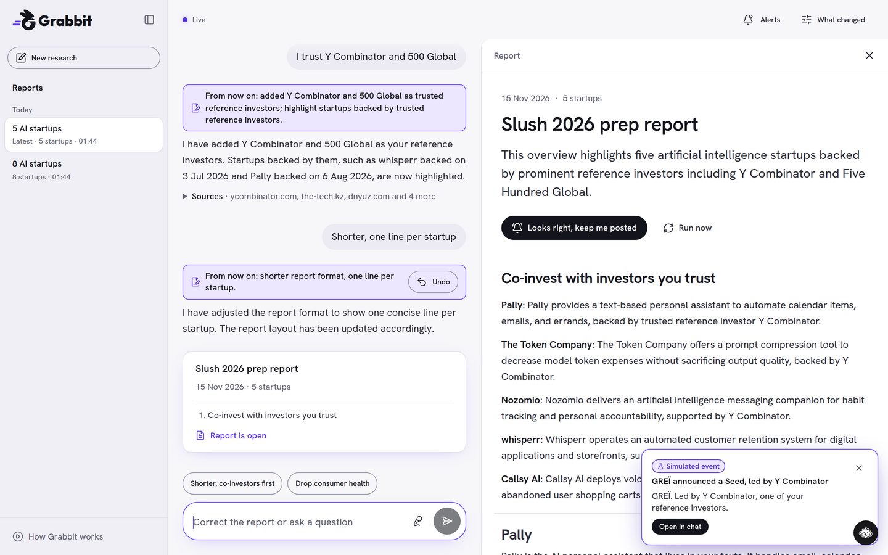 | **Report, correction, alert.** "Co-invest with investors you trust" leads the report; "Shorter, one line per startup" rewrote it; the staged alert lands, labelled "Simulated event". |

## Architecture

One FastAPI process serves the API and runs the scheduler. The browser talks REST and
listens to a Server-Sent Events stream. Every call to Cala goes through one cached client
([architecture.md](agents/architecture.md)).

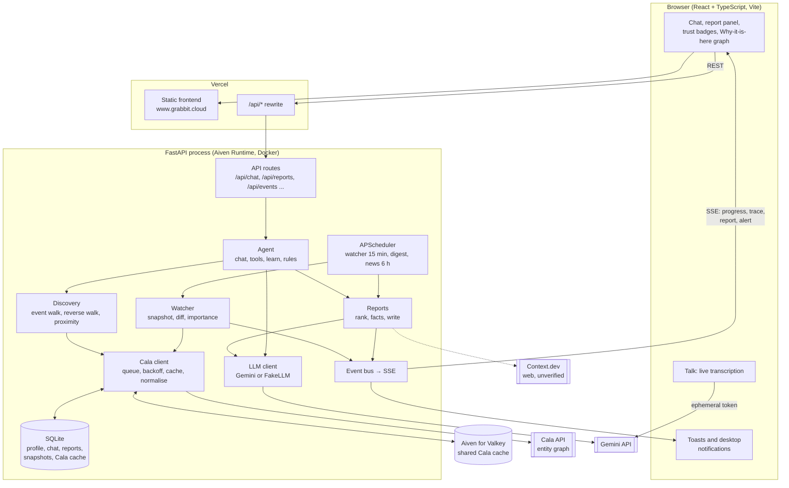

Design choices worth knowing:

| Choice | Why |
| --- | --- |
| One process, one worker | The scheduler lives in the process; more workers would duplicate jobs |
| No login, one anonymous workspace per browser | Demo visitors never share state; caches stay shared |
| Server-Sent Events, not websockets | One-way push is all alerts and progress need |
| Pydantic models generate the TypeScript client | The frontend cannot drift from the API |
| `CALA_MODE=replay` and `LLM_MODE=fake` | The whole product runs offline, for tests and bad wifi |

## A chat turn, step by step

What happens between "I trust Y Combinator and 500 Global" and the report opening.

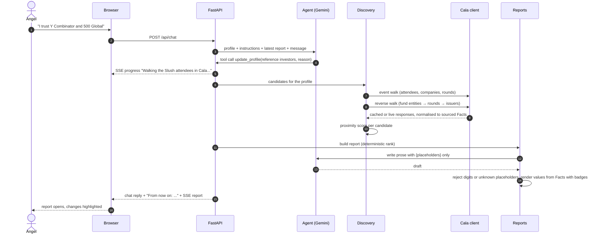

## Discovery: two walks over Cala's graph

Cala returns one node per call and has no "list by criteria". Reading 2,989 attendees costs
about 9,000 serial calls. So Grabbit meets in the middle: it expands the few investors the
angel trusts towards the attendee list and intersects
([algorithm.md](algorithm.md#the-new-algorithm)).

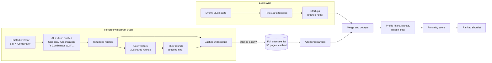

The graph it walks, in Cala's own terms:

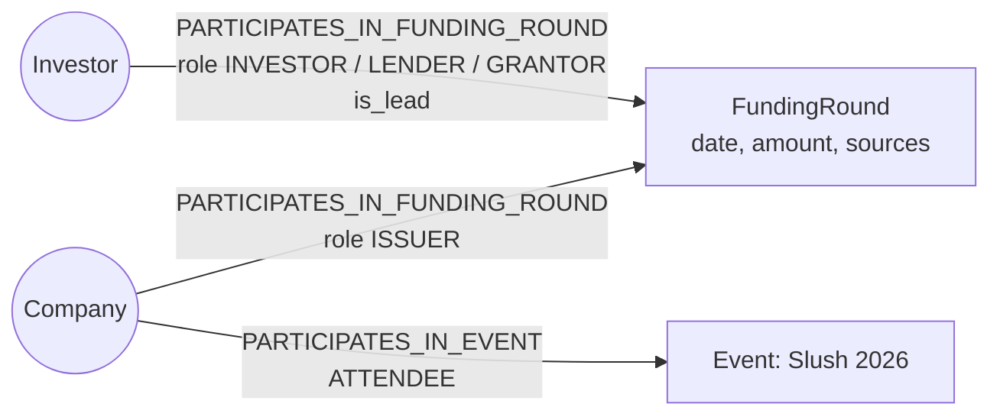

What it changed, with Y Combinator and 500 Global as trusted investors:

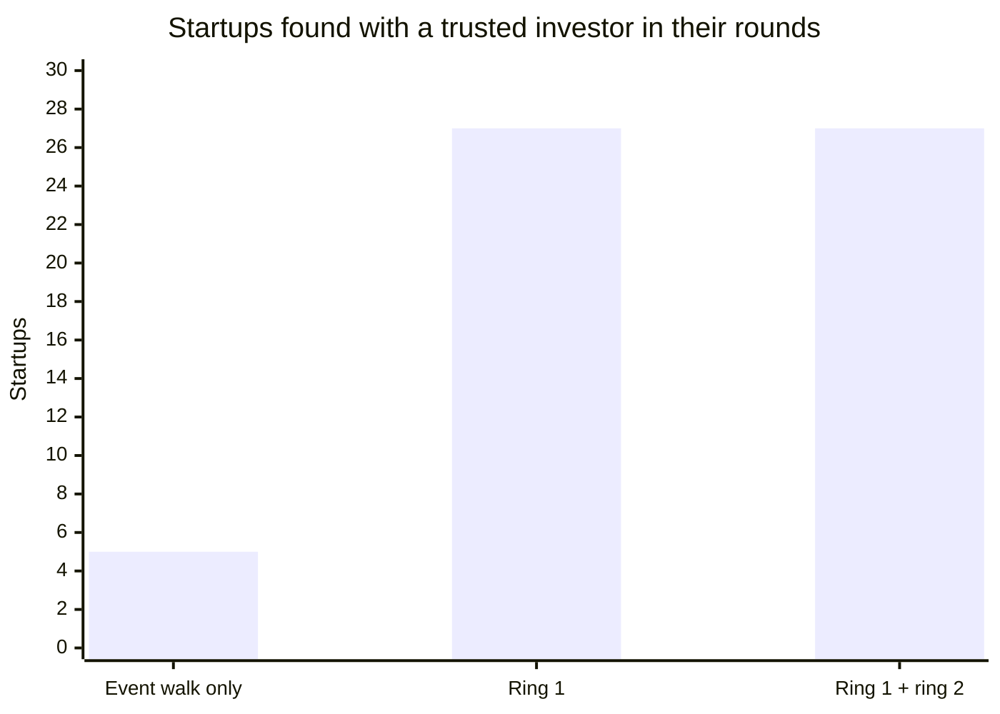

| KPI | Before | Ring 1 | Ring 1 + ring 2 |
| --- | --- | --- | --- |
| Candidates | 74 | 96 | 108 |
| Startups with a trusted investor in their rounds | 5 | 27 | 27 |
| Candidates with any path to a trusted investor | 5 | 33 | 45 |
| New startups the event walk never saw | 0 | 22 | 34 |

## Ranking: the proximity score

A path joins a startup to a trusted investor. Ring 1: the trusted investor took part in one
of the startup's rounds. Ring 2: one of the startup's investors shared another round with a
trusted investor. Each path's strength is a product of factors; the score is the sum of the
five strongest paths, and those five are the ones shown, so the number is never a black box
([algorithm.md](algorithm.md#4-proximity-score-192)).

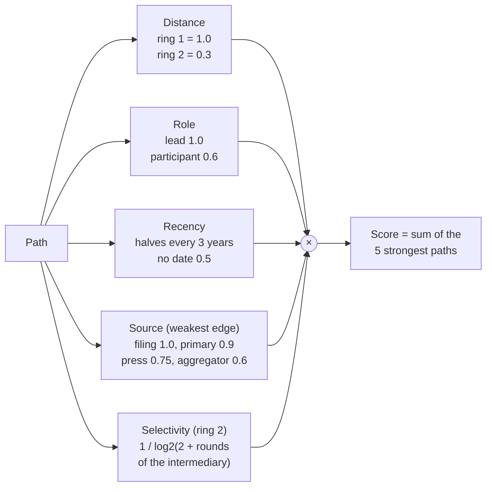

Worked example, trusted investor Y Combinator:

| Startup | Path | Strength |
| --- | --- | --- |
| A | Y Combinator led its 2026 Seed, reported by the company | 1.0 × 1.0 × ~1.0 × 0.9 = **0.90** |
| B | A small fund (6 rounds) joined its round and shared a 2025 round with Y Combinator, both from press | 0.3 × 0.6 × 0.79 × 0.75 × 1/log2(8) = **0.036** |
| C | No path | **0** |

Ties fall back to "likely to raise soon", then the most recent round, then the name
([reports/rank.py](../backend/app/reports/rank.py)).

## Trust: from `source_rank` to a badge

Every value on screen is a `Fact` with its source and trust level. A fact with several
sources shows the strongest; the score uses the weakest edge of a path, so Grabbit never
claims more trust than Cala states ([agent.md](agents/agent.md)).

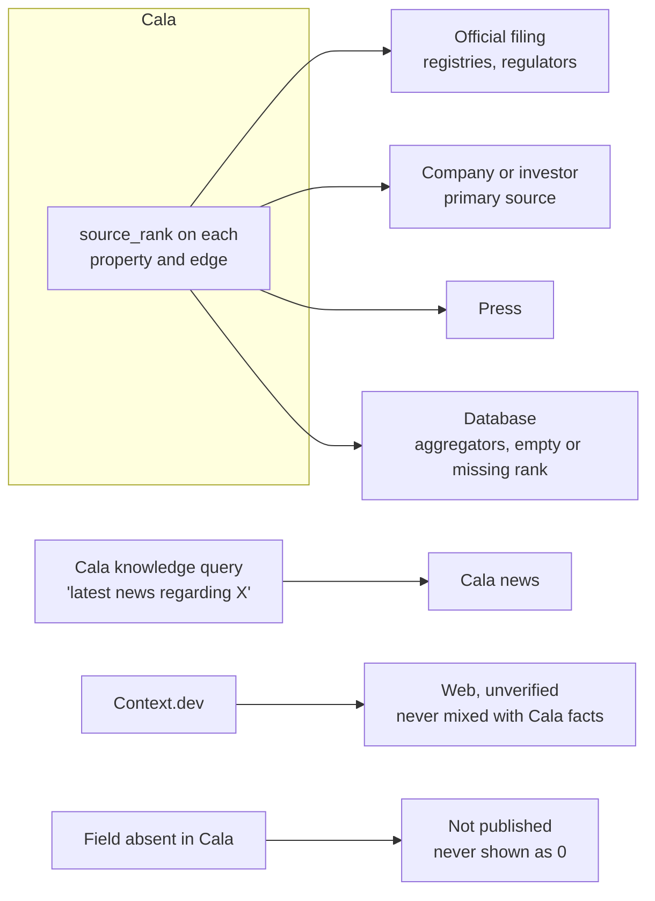

Dates keep their precision: a year-only date reads "2019", never "2019-01-01".

## Self-personalization: the agent rewrites itself

The profile has structured fields (filters, reference investors, style, cadence, alert
threshold) and free-text `instructions` that Gemini writes for itself. Each turn it can call
`update_profile` or `rewrite_instructions`. If it called neither, a second pass asks whether
the reaction implies a lasting preference ([agent.md](agents/agent.md)).

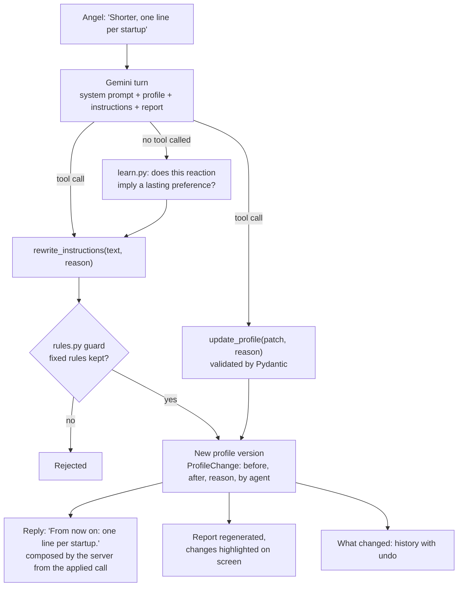

## Proactivity: watcher, digest and alerts

Cala has no push or webhooks, so Grabbit polls and diffs, modelled on scheduled
"routines": a run remembers the last state and stays silent when nothing changed
([flow.md](agents/flow.md#4-proactive-architecture)).

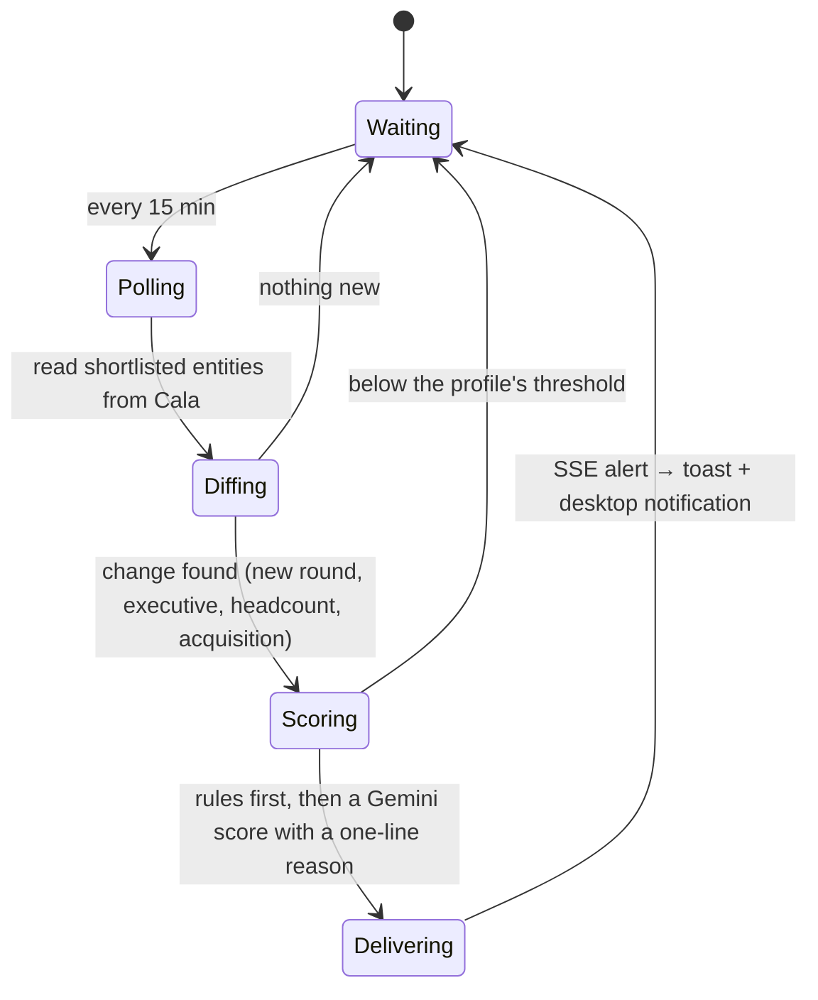

| Routine | When | What |
| --- | --- | --- |
| Watcher | Every 15 minutes | Diff the shortlist against the last snapshot, score, alert |
| Digest | Prep report, daily in the event week, weekly after | What changed and why, new matches |
| News | Every 6 hours, first run a minute after start | Cala news for the latest report's startups, cached for reports |
| Demo trigger | "Alerts" button, `DEMO_MODE=1` | A scripted change through the same diff, scoring and delivery, labelled "Simulated event" |

## Guardrails

| Risk | Guardrail | Where |
| --- | --- | --- |
| The model invents a number | Report prose cites values only as `{placeholders}`; the server renders them from sourced facts and rejects drafts with digits or unknown placeholders | [reports/write.py](../backend/app/reports/write.py) |
| The agent recommends a purchase | Fixed rules in the system prompt and a deterministic guard on `rewrite_instructions` | [agent/rules.py](../backend/app/agent/rules.py) |
| The agent claims a change it did not make | "From now on" is composed by the server from the applied tool call | [agent/chat.py](../backend/app/agent/chat.py) |
| A chart draws a walk that did not happen | Visual answers that reference unseen entities are dropped | [agent/visual.py](../backend/app/agent/visual.py) |
| Staged data mixes with real data | The demo event lives in its own fixture, never in the Cala cache | [fixtures/demo_events/](../backend/app/fixtures/demo_events/) |
| Venue wifi or Cala down | Every response cached, replay mode, `make warm --check` before a demo | [cala/client.py](../backend/app/cala/client.py) |
| The Gemini key leaks to the browser | Live transcription uses a single-use ephemeral token | [api/transcribe.py](../backend/app/api/transcribe.py) |

## Data model

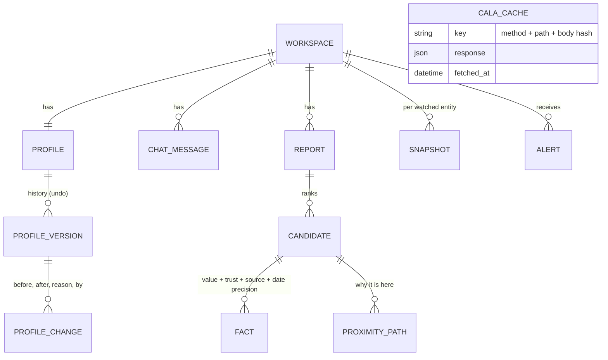

The Cala and Context.dev caches are shared across workspaces; everything else is filtered
by the browser's anonymous workspace id.

## Where things live

| Part | Code | Deeper reading |
| --- | --- | --- |
| Cala client, cache, rate limit | [backend/app/cala/](../backend/app/cala/) | [agents/cala.md](agents/cala.md) |
| Event walk, reverse walk, proximity | [backend/app/discovery/](../backend/app/discovery/) | [algorithm.md](algorithm.md) |
| Fund identity | [backend/app/trusted.py](../backend/app/trusted.py) | [algorithm.md](algorithm.md#3-one-fund-one-identity-196) |
| Signals | [backend/app/signals/](../backend/app/signals/) | [agents/agent.md](agents/agent.md) |
| Agent and its tools | [backend/app/agent/](../backend/app/agent/) | [agents/agent.md](agents/agent.md) |
| Reports | [backend/app/reports/](../backend/app/reports/) | [agents/flow.md](agents/flow.md) |
| Watcher and scheduler | [backend/app/watcher/](../backend/app/watcher/), [scheduler.py](../backend/app/scheduler.py) | [agents/flow.md](agents/flow.md) |
| Web app | [frontend/src/](../frontend/src/) | [agents/frontend.md](agents/frontend.md), [DESIGN.md](../DESIGN.md) |
| API contract | [backend/app/models.py](../backend/app/models.py) | [agents/api.md](agents/api.md) |
