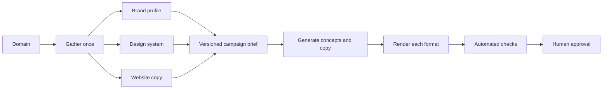

# Generate campaign assets

> Use company logos, design tokens, and website copy to create a reusable campaign brief.

```text Recipe prompt theme={null}
Implement this recipe in my project:
https://docs.context.dev/use-cases/branded-campaign-assets.md

Read the recipe and linked API guides, inspect this project's stack, and build the complete flow using its existing conventions.

Gather Brand, Styleguide, and selected website copy into a versioned campaign brief. Keep claims tied to their sources and use reviewed asset IDs. Generate ad, social, and video formats using the project's generator and renderer. Preserve edits, handle missing inputs, and keep each rendered format tied to the brief version.

Reuse existing Context.dev configuration and keep secret API keys on the server. If Context.dev is not set up yet, follow https://docs.context.dev/agent-quickstart.md first. Add focused tests, run the relevant checks, and document setup and how to try the result.
```

Gather a company's logos, design tokens, and website copy into one campaign brief. Your generator and renderer can reuse that brief across ads, social posts, and other formats.

Start with a server-side API key from the [Quickstart](https://docs.context.dev/quickstart.md) and your choice of generator and renderer. See [credits](https://docs.context.dev/account/credits.md) for how each request is charged.

## How it works



Keep factual claims traceable to website content. Review generated headlines, concepts, and layouts before publishing.

## Gather brand context

Use three endpoints with distinct jobs:

| Source | Use it for | Do not assume |
| - | - | - |
| [Brand profile](https://docs.context.dev/brand/lookup-by-domain.md) | Name, logo candidates, backdrops, and optional metadata | Every field or asset is present |
| [Styleguide](https://docs.context.dev/brand/styleguide.md) | Observed colors, typography, spacing, and component styles | Extracted tokens are an official brand standard |
| [Website crawl](https://docs.context.dev/crawl/overview) | Current positioning, product language, proof, and source URLs | Every reachable page is authoritative or current |

```typescript TypeScript theme={null}
import ContextDev from "context.dev";

const client = new ContextDev({apiKey: process.env.CONTEXT_DEV_API_KEY});

export async function gatherCampaignContext(domain: string) {
  const [brandResult, styleguideResult, crawlResult] = await Promise.allSettled([
    client.brand.retrieve({type: "by_domain", domain}),
    client.web.extractStyleguide({domain}),
    client.web.webCrawlMd({
      url: `https://${domain}`,
      maxPages: 30,
      stopAfterMs: 80_000,
    }),
  ]);

  const brand = brandResult.status === "fulfilled" ? brandResult.value : null;
  const styleguide = styleguideResult.status === "fulfilled" ? styleguideResult.value : null;
  const crawl = crawlResult.status === "fulfilled" ? crawlResult.value : null;
  return {
    domain,
    gatheredAt: new Date().toISOString(),
    brand: brand?.brand ?? {},
    styleguide: styleguide?.styleguide ?? {},
    sources: {
      brand: brandResult.status,
      styleguide: styleguideResult.status,
      crawl: crawlResult.status,
    },
    pages: (crawl?.results ?? [])
      .filter((page) => page.metadata.success && page.markdown.trim())
      .map((page) => ({
        url: page.metadata.url,
        title: page.metadata.title,
        markdown: page.markdown,
      })),
  };
}

console.log(await gatherCampaignContext("example.com"));
```

```python Python theme={null}
import os
from context.dev import ContextDev

client = ContextDev(api_key=os.environ["CONTEXT_DEV_API_KEY"])
domain = "example.com"

brand = client.brand.retrieve(type="by_domain", domain=domain)
styleguide = client.web.extract_styleguide(domain=domain)
crawl = client.web.web_crawl_md(
    url=f"https://{domain}",
    max_pages=30,
    stop_after_ms=80_000,
)

context = {
    "brand": brand,
    "styleguide": styleguide,
    "pages": [page for page in crawl.results if page.metadata.success],
}
print(context)
```

```ruby Ruby theme={null}
require "cgi/core"
require "context_dev"

client = ContextDev::Client.new(api_key: ENV.fetch("CONTEXT_DEV_API_KEY"))
domain = "example.com"

brand = client.brand.retrieve(body: {type: :by_domain, domain: domain})
styleguide = client.web.extract_styleguide(domain: domain)
crawl = client.web.web_crawl_md(
  url: "https://#{domain}",
  max_pages: 30,
  stop_after_ms: 80_000,
)

context = {
  brand: brand,
  styleguide: styleguide,
  pages: crawl.results.select { |page| page.metadata.success },
}
puts context.inspect
```

```go Go theme={null}
package main

import (
    "context"
    "fmt"
    "os"

    contextdev "github.com/context-dot-dev/context-go-sdk/v2"
    "github.com/context-dot-dev/context-go-sdk/v2/option"
    "github.com/context-dot-dev/context-go-sdk/v2/packages/param"
)

func main() {
    client := contextdev.NewClient(
        option.WithAPIKey(os.Getenv("CONTEXT_DEV_API_KEY")),
    )

    domain := "example.com"
    brand, err := client.Brand.Get(context.Background(), contextdev.BrandGetParams{
        OfByDomain: &contextdev.BrandGetParamsBodyByDomain{Domain: domain},
    })
    if err != nil {
        panic(err)
    }

    styleguide, err := client.Web.ExtractStyleguide(context.Background(), contextdev.WebExtractStyleguideParams{
        Domain: param.NewOpt(domain),
    })
    if err != nil {
        panic(err)
    }

    crawl, err := client.Web.WebCrawlMd(context.Background(), contextdev.WebWebCrawlMdParams{
        URL: "https://" + domain,
        MaxPages: param.NewOpt[int64](30),
        StopAfterMs: param.NewOpt[int64](80_000),
    })
    if err != nil {
        panic(err)
    }

    pages := make([]map[string]any, 0)
    for _, page := range crawl.Results {
        if page.Metadata.Success {
            pages = append(pages, map[string]any{
                "url": page.Metadata.URL,
                "title": page.Metadata.Title,
                "markdown": page.Markdown,
            })
        }
    }
    fmt.Println(map[string]any{"brand": brand, "styleguide": styleguide, "pages": pages})
}
```

```php PHP theme={null}
<?php

require __DIR__.'/vendor/autoload.php';

use ContextDev\Client;

$client = new Client(apiKey: getenv('CONTEXT_DEV_API_KEY'));

$domain = 'example.com';

// The PHP Brand helper requires fields from incompatible lookup types.
$raw = $client->request(
    method: 'post',
    path: 'brand/retrieve',
    body: ['type' => 'by_domain', 'domain' => $domain],
);
$brand = json_decode((string) $raw->getBody(), true, flags: JSON_THROW_ON_ERROR);
$styleguide = $client->web->extractStyleguide(domain: $domain);
$crawl = $client->web->webCrawlMd(
    url: 'https://'.$domain,
    maxPages: 30,
    stopAfterMs: 80_000,
);

$pages = array_values(array_filter(
    $crawl->results,
    fn ($page) => $page->metadata->success,
));
print_r(compact('brand', 'styleguide', 'pages'));
```

```bash cURL theme={null}
curl https://api.context.dev/v1/brand/retrieve \
  --request POST \
  --header "Authorization: Bearer $CONTEXT_DEV_API_KEY" \
  --header "Content-Type: application/json" \
  --data '{"type":"by_domain","domain":"example.com"}'

curl --get https://api.context.dev/v1/web/styleguide \
  --header "Authorization: Bearer $CONTEXT_DEV_API_KEY" \
  --data-urlencode "domain=example.com"

curl https://api.context.dev/v1/web/crawl \
  --request POST \
  --header "Authorization: Bearer $CONTEXT_DEV_API_KEY" \
  --header "Content-Type: application/json" \
  --data '{"url":"https://example.com","maxPages":30,"stopAfterMs":80000}'
```

Keep this on the server. Validate `domain` before interpolating it, and apply your own allowlist if users can submit arbitrary targets.

> [!NOTE]
>
> The TypeScript gather function preserves successful inputs when another call fails. The other tabs show the individual requests; apply the same independent error handling in your worker. A fulfilled call can still return missing fields or empty pages. Use a neutral theme or approved existing assets when visual inputs are absent, and require sourced or user-approved copy before generating factual claims.

## Build a campaign brief

Do not pass a raw crawl directly to a generator. First distill a compact, reviewable brief:

```typescript TypeScript model theme={null}
type CampaignBrief = {
  brandName?: string;
  objective: string;
  audience: string;
  approvedClaims: Array<{ text: string; sourceUrl: string }>;
  voiceEvidence: Array<{ excerpt: string; sourceUrl: string }>;
  prohibitedClaims: string[];
  logoCandidates: Array<{ url: string; mode?: string }>;
  palette: string[];
  typography: Record<string, unknown>;
  sourceVersion: string;
};
```

Require a URL for each factual claim. Keep customer names, numerical claims, certifications, and comparisons out of the generated copy unless they are explicitly approved.

Treat the extracted design system as evidence from the rendered site. A designer can approve or override the palette, typography, and preferred logo before the first campaign is rendered.

## Generate the content

Ask your model or rules engine for a bounded object that the renderer controls:

```json theme={null}
{
  "concept": "One clear campaign idea",
  "headline": "Short headline",
  "supporting_text": "One supporting sentence",
  "cta": "Action label",
  "claim_source_urls": ["https://example.com/product"],
  "visual_direction": "Composition guidance, not executable code"
}
```

Validate length, required sources, and prohibited terms before rendering. Keeping generation separate from layout makes it easier to:

* enforce safe zones and text limits;
* update platform dimensions without changing the prompt;
* render the same concept across multiple sizes;
* reject unsupported claims before they appear in an image;
* compare output against a stable snapshot.

## Render each format

Reuse one approved concept across formats while keeping each format's content contract explicit. [Knowlify uses brand assets in generated videos](https://www.context.dev/blog/knowlify-ships-accurate-branded-video-assets-in-under-five-minutes-with-context-dev); the same source bundle can support still and moving creative.

| Format | Additional application inputs |
| - | - |
| Product ad | Exact product, approved offer, destination URL, and safe area |
| Social post | Platform-specific copy length, separate caption, and image description |
| Short video | Ordered scenes, scene durations, captions, logo placement, and licensed audio |

Platform dimensions change. Store them as configuration instead of embedding them in generation logic:

```typescript TypeScript renderer theme={null}
const formats = {
  square: { width: 1080, height: 1080 },
  portrait: { width: 1080, height: 1350 },
  landscape: { width: 1200, height: 628 },
};

for (const [name, size] of Object.entries(formats)) {
  await renderCampaign({ name, size, creative, brief });
}
```

Verify the current requirements of each destination before publishing. Render with your own component system, canvas pipeline, or HTML-to-image service; Context.dev supplies the source context, not the final creative approval.

## Keep imagery attached to the right offer

Use [page images](https://docs.context.dev/scrape/images.md) to gather candidates, then save a reviewed asset registry:

```typescript Approved asset model theme={null}
type ApprovedAsset = {
  id: string;
  url: string;
  sourceUrl: string;
  offerId: string | null;
  width: number;
  height: number;
  alt: string;
};
```

These IDs are application fields. An image scrape returns each image's `url` and `alt`; it does not establish which offer an image belongs to. Keep unverified associations null and avoid pairing an offer with an image of a different item. Have the generator return an approved asset ID, and resolve it through your registry in the renderer.

If an optional asset fails to load, use a reviewed alternative or a layout that works without it. Keep the same policy for fonts: an unavailable custom font should fall back without hiding or clipping the headline. Record which fallback was rendered with the output version.

## Review the assets

Automate checks before human review:

* Every factual claim has an approved source URL.
* The chosen logo has enough contrast against its background.
* Text stays inside the safe area and does not overflow at any size.
* Remote images load successfully and have sufficient resolution.
* Fonts have a licensed, loadable source and a tested fallback.
* Color contrast meets your accessibility target.
* Generated copy contains no unapproved customer, legal, security, or performance claims.
* Each output records the campaign-brief version and source timestamp.

> [!WARNING]
>
> Discovering an image, font, logo, or phrase does not grant permission to reuse it. Confirm trademark, copyright, font licensing, endorsement, and platform-policy requirements before publishing.

## Refresh the brief

Cache the gathered bundle and refresh it intentionally. When the website changes, generate a diff and ask an editor to approve changes to the campaign brief instead of silently changing active creative.

> [card] [Monitor website changes](https://docs.context.dev/monitors/overview)
>
> Detect source changes before refreshing the brief.

> [card] [API stability](https://docs.context.dev/optimization/trust.md)
>
> Plan for response changes and schema upgrades.

> [card] [Branded documents](https://docs.context.dev/use-cases/branded-documents.md)
>
> Reuse approved brand decisions in decks and client deliverables.

> [card] [Responsible use](https://docs.context.dev/optimization/responsible-use.md)
>
> Review legal and policy requirements before publishing.


This documentation is built and hosted on [Mintlify](https://mintlify.com), a developer documentation platform.