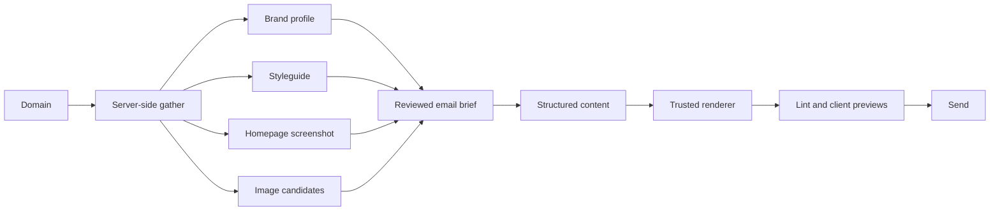

# Build branded emails

> Turn a company's logo, colors, and website imagery into an email brief and tested HTML template.

```text Recipe prompt theme={null}
Implement this recipe in my project:
https://docs.context.dev/use-cases/custom-email-templates.md

Read the recipe and linked API guides, inspect this project's stack, and build the complete flow using its existing conventions.

Gather Brand, Styleguide, Screenshot, and Images into an editable email brief, handling each source independently. Generate structured content and render it through a trusted email template with reviewed assets, fallbacks, the correct sender, and a footer. Preserve manual edits and provide a preview with email-client checks.

Reuse existing Context.dev configuration and keep secret API keys on the server. If Context.dev is not set up yet, follow https://docs.context.dev/agent-quickstart.md first. Add focused tests, run the relevant checks, and document setup and how to try the result.
```

Gather a company's logo, colors, fonts, and imagery, then turn them into an email template. Context.dev supplies the brand context; your application generates the content, renders the HTML, and sends the message.

Start with an API key from the [Quickstart](https://docs.context.dev/quickstart.md), an email renderer, and a delivery provider. See [credits](https://docs.context.dev/account/credits.md) for the cost of Brand, Styleguide, and Scrape requests.

## How it works



Context.dev gathers source evidence. Your application still owns copy approval, asset rights, email markup, client testing, and delivery.

## Gather visual context

Call the APIs from your server and read `CONTEXT_DEV_API_KEY` from the environment:

```typescript TypeScript theme={null}
import ContextDev from "context.dev";

const client = new ContextDev({apiKey: process.env.CONTEXT_DEV_API_KEY});

export async function gatherEmailContext(domain: string) {
  const homepage = `https://${domain}`;

  const results = await Promise.allSettled([
    client.brand.retrieve({type: "by_domain", domain}),
    client.web.extractStyleguide({domain}),
    client.web.scrape({url: homepage, formats: {screenshot: true}}),
    client.web.scrape({url: homepage, formats: {images: true}}),
  ]);

  const [brand, styleguide, screenshot, images] = results;
  const names = ["brand", "styleguide", "screenshot", "images"];
  return {
    domain,
    gatheredAt: new Date().toISOString(),
    brand: brand.status === "fulfilled" ? brand.value : null,
    styleguide: styleguide.status === "fulfilled" ? styleguide.value : null,
    screenshot: screenshot.status === "fulfilled" ? screenshot.value.screenshot.data : null,
    images: images.status === "fulfilled" ? images.value.images.data : null,
    missingSources: results.flatMap((result, index) =>
      result.status === "rejected" ? [names[index]] : []),
  };
}

console.log(await gatherEmailContext("example.com"));
```

```python Python theme={null}
import os
from context.dev import ContextDev

client = ContextDev(api_key=os.environ["CONTEXT_DEV_API_KEY"])
domain = "example.com"

brand = client.brand.retrieve(type="by_domain", domain=domain)
styleguide = client.web.extract_styleguide(domain=domain)
homepage = f"https://{domain}"
screenshot = client.web.scrape(url=homepage, formats={"screenshot": True})
images = client.web.scrape(url=homepage, formats={"images": True})

print({
    "brand": brand,
    "styleguide": styleguide,
    "screenshot": screenshot.screenshot.data,
    "images": images.images.data,
})
```

```ruby Ruby theme={null}
require "cgi/core"
require "context_dev"

client = ContextDev::Client.new(api_key: ENV.fetch("CONTEXT_DEV_API_KEY"))
domain = "example.com"

brand = client.brand.retrieve(body: {type: :by_domain, domain: domain})
styleguide = client.web.extract_styleguide(domain: domain)
homepage = "https://#{domain}"
screenshot = client.web.scrape(url: homepage, formats: {screenshot: true})
images = client.web.scrape(url: homepage, formats: {images: true})

puts({
  brand: brand,
  styleguide: styleguide,
  screenshot: screenshot.screenshot.data,
  images: images.images.data,
}.inspect)
```

```go Go theme={null}
package main

import (
    "context"
    "fmt"
    "os"

    contextdev "github.com/context-dot-dev/context-go-sdk/v2"
    "github.com/context-dot-dev/context-go-sdk/v2/option"
    "github.com/context-dot-dev/context-go-sdk/v2/packages/param"
)

func main() {
    client := contextdev.NewClient(
        option.WithAPIKey(os.Getenv("CONTEXT_DEV_API_KEY")),
    )

    domain := "example.com"
    brand, err := client.Brand.Get(context.Background(), contextdev.BrandGetParams{
        OfByDomain: &contextdev.BrandGetParamsBodyByDomain{Domain: domain},
    })
    if err != nil {
        panic(err)
    }

    styleguide, err := client.Web.ExtractStyleguide(context.Background(), contextdev.WebExtractStyleguideParams{
        Domain: param.NewOpt(domain),
    })
    if err != nil {
        panic(err)
    }

    homepage := "https://" + domain
    screenshot, err := client.Web.Scrape(context.Background(), contextdev.WebScrapeParams{
        URL:     homepage,
        Formats: contextdev.WebScrapeParamsFormats{Screenshot: contextdev.Bool(true)},
    })
    if err != nil {
        panic(err)
    }

    images, err := client.Web.Scrape(context.Background(), contextdev.WebScrapeParams{
        URL:     homepage,
        Formats: contextdev.WebScrapeParamsFormats{Images: contextdev.Bool(true)},
    })
    if err != nil {
        panic(err)
    }

    fmt.Println(map[string]any{
        "brand": brand,
        "styleguide": styleguide,
        "screenshot": screenshot.Screenshot.Data,
        "images": images.Images.Data,
    })
}
```

```php PHP theme={null}
<?php

require __DIR__.'/vendor/autoload.php';

use ContextDev\Client;

$client = new Client(apiKey: getenv('CONTEXT_DEV_API_KEY'));

$domain = 'example.com';

// The PHP Brand helper requires fields from incompatible lookup types.
$raw = $client->request(
    method: 'post',
    path: 'brand/retrieve',
    body: ['type' => 'by_domain', 'domain' => $domain],
);
$brand = json_decode((string) $raw->getBody(), true, flags: JSON_THROW_ON_ERROR);
$styleguide = $client->web->extractStyleguide(domain: $domain);
$homepage = 'https://'.$domain;
$screenshot = $client->web->scrape(formats: ['screenshot' => true], url: $homepage);
$images = $client->web->scrape(formats: ['images' => true], url: $homepage);

print_r([
    'brand' => $brand,
    'styleguide' => $styleguide,
    'screenshot' => $screenshot->screenshot->data,
    'images' => $images->images->data,
]);
```

```bash cURL theme={null}
curl https://api.context.dev/v1/brand/retrieve \
  --request POST \
  --header "Authorization: Bearer $CONTEXT_DEV_API_KEY" \
  --header "Content-Type: application/json" \
  --data '{"type":"by_domain","domain":"example.com"}'

curl --get https://api.context.dev/v1/web/styleguide \
  --header "Authorization: Bearer $CONTEXT_DEV_API_KEY" \
  --data-urlencode "domain=example.com"

curl https://api.context.dev/v1/web/scrape \
  --request POST \
  --header "Authorization: Bearer $CONTEXT_DEV_API_KEY" \
  --header "Content-Type: application/json" \
  --data '{"url":"https://example.com","formats":{"screenshot":true}}'

curl https://api.context.dev/v1/web/scrape \
  --request POST \
  --header "Authorization: Bearer $CONTEXT_DEV_API_KEY" \
  --header "Content-Type: application/json" \
  --data '{"url":"https://example.com","formats":{"images":true}}'
```

The two scrape requests target the same page and are billed independently; see [credits](https://docs.context.dev/account/credits.md). Scrape outputs fail independently, so you can also request `screenshot` and `images` together in one request and pay the base price once: a failed screenshot leaves the image list usable. Add `imageParams: {enrich: ["dimensions"]}` to the images request when the template needs pixel sizes; see [Enrich the images](https://docs.context.dev/scrape/images.md#enrich-and-deduplicate).

Use each response for a specific purpose:

| Input | Purpose |
| - | - |
| Brand profile | Select a logo candidate and optional brand metadata. |
| Styleguide | Observe palette, typography, spacing, and component treatment. |
| Screenshot | Give a reviewer or vision model a visual reference for the rendered site. `screenshot.data` is an image data URL that works as an `` source. |
| Images | Find candidate image URLs and alt text in `images.data`. The array is empty when the page has no images. |

All nested fields and asset lists can be absent. The TypeScript function keeps successful responses and names the calls that failed; the other tabs show the underlying requests. Apply the same independent error handling in your language, and also check for empty fields in fulfilled responses.

| Missing input | Template behavior |
| - | - |
| Logo | Show the confirmed sender name as text. |
| Styleguide or custom font | Use an approved neutral palette and system-font stack. |
| Screenshot | Continue without a visual reference. |
| Hero image | Use a text-first layout; do not substitute an unrelated product image. |
| Supported campaign facts | Ask the editor for approved copy before generating factual claims. |

Validate the submitted domain on your server, cache the gathered bundle, and avoid requesting the same source context for every recipient.

## Create an email brief

Do not treat extracted website styles as email-ready CSS. Convert them into a small set of approved decisions:

```typescript TypeScript model theme={null}
type EmailBrief = {
  brandName: string;
  logo?: { url: string; alt: string; width: number; height: number };
  primaryColor: string;
  backgroundColor: string;
  textColor: string;
  fontStack: string;
  heroImage?: { url: string; alt: string };
  toneEvidence: Array<{ excerpt: string; sourceUrl: string }>;
  campaignGoal: string;
  requiredFooter: string;
};
```

Approve contrast, image choice, font licensing, and fallback fonts before generation. A homepage screenshot is a reference, not an instruction to reproduce a site's layout inside an email.

## Generate the content

For production, have the model produce content and design choices as structured data. Keep executable HTML in a renderer you control.

```json theme={null}
{
  "subject": "A specific, truthful subject line",
  "preheader": "A short summary",
  "eyebrow": "Optional category",
  "headline": "One clear message",
  "body": "Two concise paragraphs",
  "cta": {
    "label": "Action-oriented label",
    "url": "https://example.com/approved-destination"
  },
  "image_key": "approved-hero-1"
}
```

Validate the output against a schema. Restrict links and images to an approved allowlist, and reject unsupported performance, customer, security, or legal claims.

> [!TIP]
>
> A model can generate complete HTML for a prototype. A deterministic component renderer is safer in production because it controls markup, escaping, responsive behavior, and footer requirements.

## Render for email clients

Web layouts do not transfer directly to email. Your renderer should:

* use semantic, email-compatible table layouts where needed;
* inline critical styles and avoid JavaScript, forms, and remote stylesheets;
* include explicit image dimensions and meaningful `alt` text;
* constrain content to a readable single-column layout on small screens;
* supply system-font fallbacks when custom fonts are unavailable;
* encode and validate all URLs;
* preserve the required sender identity, unsubscribe controls, and legal footer;
* keep the final message below your delivery provider's and mailbox clients' size limits.

Do not place untrusted model output directly into an HTML string. Escape text and accept only typed components and approved URL schemes.

## Test the message

Linting source HTML is not enough. Before sending:

1. Render screenshots in the mailbox clients and modes your audience uses.
2. Test with blocked images, dark mode, narrow screens, and long localized copy.
3. Click every link and verify tracking parameters do not break the destination.
4. Confirm the plain-text alternative remains understandable.
5. Run accessibility and spam checks.
6. Send a seed-list test through the same delivery path as production.

Record the source-evidence timestamp and template version. When the brand site changes, review the diff before changing an active template.

## Reuse a theme across email types

[Sequenzy uses brand context for personalized marketing emails](https://www.context.dev/blog/sequenzy-creates-personalized-marketing-emails-in-seconds-with-brand-dev). Reuse the approved visual brief while keeping message purpose and sender identity explicit:

| Template | Content supplied by your application |
| - | - |
| Welcome email | The customer's actual signup state and next action |
| Product announcement | Approved product facts, imagery, and campaign destination |
| Account or transaction notification | Accurate event data from your application |
| Newsletter | Reviewed editorial copy, links, and required footer |

Keep recipient personalization separate from the brand theme. Save logo, color, and font overrides against the sending brand, and retain those overrides when refreshing automatic candidates. A source-site change should create a draft template revision rather than changing messages already approved for a campaign.

> [!WARNING]
>
> An asset returned from a public webpage is not automatically licensed for email use. Confirm permission for logos, images, fonts, customer marks, and quoted language.

> [card] [Retrieve brand data](https://docs.context.dev/brand/overview)
>
> Find company profiles and logo candidates.

> [card] [Extract a styleguide](https://docs.context.dev/brand/styleguide.md)
>
> Inspect a website's colors and typography.

> [card] [Capture a screenshot](https://docs.context.dev/scrape/screenshot.md)
>
> Capture a rendered page for visual reference.

> [card] [Extract page images](https://docs.context.dev/scrape/images.md)
>
> Find candidate image URLs for your template.


This documentation is built and hosted on [Mintlify](https://mintlify.com), a developer documentation platform.