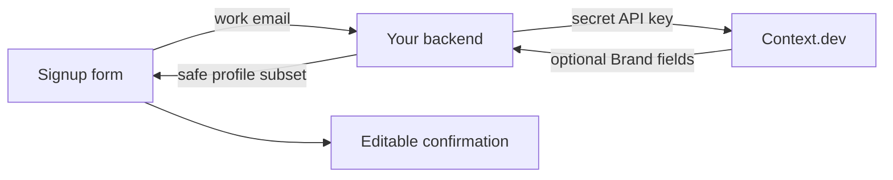

# Prefill and personalize onboarding

> Turn a business email into editable company fields and a workspace theme without blocking signup or replacing user choices.

```text Recipe prompt theme={null}
Implement this recipe in my project:
https://docs.context.dev/use-cases/faster-onboarding-flows.md

Read the recipe and linked API guides, inspect this project's stack, and build the complete flow using its existing conventions.

Use a work email to retrieve a Brand profile, prefill editable company fields, and seed a workspace theme. Keep signup usable when enrichment is slow, missing, or fails. Let users correct or skip suggestions, and preserve their saved fields, color choices, and logo removal when refreshing.

Reuse existing Context.dev configuration and keep secret API keys on the server. If Context.dev is not set up yet, follow https://docs.context.dev/agent-quickstart.md first. Add focused tests, run the relevant checks, and document setup and how to try the result.
```

Ask for a work email once, retrieve the associated Brand profile on your server, and prefill the next onboarding step. Use the same confirmed identity to seed a workspace theme. The user should always be able to correct or skip the result.

You'll need a server-side API key from the [Quickstart](https://docs.context.dev/quickstart.md). See [credits](https://docs.context.dev/account/credits.md) for Brand lookup pricing. The example uses a Next.js route, but the same request works from any backend.

## Retrieve a company profile

Use any supported SDK for the underlying lookup. The PHP tab uses the SDK's low-level Brand method; the backend and UI example below uses TypeScript and React.

```typescript TypeScript theme={null}
import ContextDev from "context.dev";

const client = new ContextDev({ apiKey: process.env.CONTEXT_DEV_API_KEY });

const response = await client.brand.retrieve({
  type: "by_domain",
  domain: "stripe.com",
});

console.log(response.brand?.title);
```

```python Python theme={null}
import os
from context.dev import ContextDev

client = ContextDev(api_key=os.environ["CONTEXT_DEV_API_KEY"])

response = client.brand.retrieve(
    type="by_domain",
    domain="stripe.com",
)

print(response.brand.title if response.brand else None)
```

```ruby Ruby theme={null}
require "cgi/core"
require "context_dev"

client = ContextDev::Client.new(api_key: ENV.fetch("CONTEXT_DEV_API_KEY"))

response = client.brand.retrieve(
  body: {
    "type" => "by_domain",
    "domain" => "stripe.com",
  }
)

puts response.brand&.title
```

```go Go theme={null}
package main

import (
    "context"
    "fmt"
    "os"

    contextdev "github.com/context-dot-dev/context-go-sdk/v2"
    "github.com/context-dot-dev/context-go-sdk/v2/option"
)

func main() {
    client := contextdev.NewClient(option.WithAPIKey(os.Getenv("CONTEXT_DEV_API_KEY")))
    response, err := client.Brand.Get(context.Background(), contextdev.BrandGetParams{
        OfByDomain: &contextdev.BrandGetParamsBodyByDomain{
            Domain: "stripe.com",
        },
    })
    if err != nil {
        panic(err)
    }
    fmt.Println(response.Brand.Title)
}
```

```php PHP theme={null}
<?php

require __DIR__.'/vendor/autoload.php';

$client = new ContextDev\Client(apiKey: getenv('CONTEXT_DEV_API_KEY'));

// Use the SDK's low-level request: its generated Brand helper cannot express this lookup.
$response = $client->request(
    method: 'post',
    path: 'brand/retrieve',
    body: [
      "type" => "by_domain",
      "domain" => "stripe.com",
    ],
);
$data = json_decode((string) $response->getBody(), true, flags: JSON_THROW_ON_ERROR);
echo $data['brand']['title'] ?? 'No match', PHP_EOL;
```

```bash cURL theme={null}
curl https://api.context.dev/v1/brand/retrieve \
  --request POST \
  --header "Authorization: Bearer $CONTEXT_DEV_API_KEY" \
  --header "Content-Type: application/json" \
  --data '{
  "type": "by_domain",
  "domain": "stripe.com"
}'
```

## What to prefill

| Form field | Brand field | Fallback |
| - | - | - |
| Company name | `brand.title` | Leave blank |
| Website | `brand.domain` | Derive the email domain for display only |
| Description | `brand.description` | Leave blank |
| Logo | A suitable item from `brand.logos[]` | Initials or a neutral icon |
| Industry | `brand.industries.eic[0]` | Ask the user |
| Social profile | Matching item in `brand.socials[]` | Omit the field |

Every field is optional. A successful response can still contain a partial profile.

## Look up the company

The browser calls your backend. Your backend validates the email and calls Context.dev with `CONTEXT_DEV_API_KEY`.



Here is a Next.js route using the HTTPS API directly so the fallback behavior is explicit:

```typescript app/api/company-profile/route.ts theme={null}
type BrandPayload = {
  brand?: {
    domain?: string;
    title?: string;
    description?: string;
    colors?: Array<{ hex: string; source: "site" | "logo" }>;
    logos?: Array<{ url: string; type?: string; mode?: string }>;
  };
  error_code?: string;
};

export async function POST(request: Request) {
  const { email } = (await request.json()) as { email?: string };

  if (typeof email !== "string" || !email.includes("@")) {
    return Response.json({ error: "Enter a valid email." }, { status: 400 });
  }

  const upstream = await fetch("https://api.context.dev/v1/brand/retrieve", {
    method: "POST",
    headers: {
      Authorization: `Bearer ${process.env.CONTEXT_DEV_API_KEY}`,
      "Content-Type": "application/json",
    },
    body: JSON.stringify({
      type: "by_email",
      email,
      timeoutOpts: { milliseconds: 10_000, behavior: "fail" },
    }),
  });

  const payload = (await upstream.json()) as BrandPayload;
  const noProfile =
    upstream.status === 422 ||
    (upstream.status === 400 && payload.error_code === "NOT_FOUND");

  if (noProfile) {
    return Response.json({ brand: null, reason: "no_business_profile" });
  }

  if (!upstream.ok) {
    return Response.json(
      { error: "Company details are temporarily unavailable." },
      { status: 503 },
    );
  }

  const brand = payload.brand;
  const accent = brand?.colors?.find(
    (color) => color.source === "site" && /^#[0-9a-f]{6}$/i.test(color.hex),
  )?.hex ?? null;
  const logoUrl = brand?.logos?.find(
    (logo) => logo.type === "logo" && logo.mode === "light" && logo.url.startsWith("https://"),
  )?.url ?? null;
  return Response.json({
    brand: brand
      ? {
          domain: brand.domain,
          title: brand.title,
          description: brand.description,
          branding: { accent, logoUrl },
        }
      : null,
  });
}
```

> [!WARNING]
>
> Do not return the upstream response wholesale. Send only the fields your form uses, and never expose the Context.dev API key or internal diagnostics to the browser.

## Fill blank fields

Start the lookup when the user submits the email step. Fill only blank fields so a slow response cannot replace edits made while the request was running.

```typescript theme={null}
const response = await fetch("/api/company-profile", {
  method: "POST",
  headers: { "Content-Type": "application/json" },
  body: JSON.stringify({ email }),
});

if (response.ok) {
  const { brand } = await response.json();

  setForm((current) => ({
    ...current,
    companyName: current.companyName || brand?.title || "",
    website: current.website || brand?.domain || "",
    description: current.description || brand?.description || "",
  }));
}
```

Show the lookup as a convenience, not as verified user input:

* Label the step “Confirm your company details.”
* Make text fields editable and the logo replaceable.
* Let the user continue when no profile is found.
* Do not treat a physical address as a legal or headquarters address without separate verification.
* Record which values the user confirmed if downstream logic depends on them.

## Seed an editable workspace theme

After the user confirms the company, use `brand.branding` from the route above as suggestions for that tenant. [Listener uses brand context for customer-specific experiences](https://www.context.dev/blog/listener-com-delivers-white-label-experiences-with-context-dev); the same pattern can personalize a workspace header or customer portal.

Keep automatic candidates separate from saved user choices. A logo may belong to a parent brand or the platform hosting the website, so provide a replacement or **Use no logo** option.

```typescript workspace-theme.ts theme={null}
type Branding = { accent: string | null; logoUrl: string | null };
type ThemeChoices = { accent?: string; logoUrl?: string | null };

export function workspaceTheme(suggested: Branding, saved: ThemeChoices) {
  const candidate = saved.accent ?? suggested.accent;
  const accent = candidate && /^#[0-9a-f]{6}$/i.test(candidate)
    ? candidate : "#334155";
  return {
    accent,
    background: "#ffffff",
    surface: "#f8fafc",
    text: "#171717",
    logoUrl: saved.logoUrl !== undefined ? saved.logoUrl : suggested.logoUrl,
  };
}
```

Map these roles to your component system rather than copying the whole extracted palette:

```tsx Workspace header theme={null}
const theme = workspaceTheme(suggestedBranding, savedThemeChoices);

<header style={{
  background: theme.surface,
  color: theme.text,
  borderTop: `4px solid ${theme.accent}`,
  padding: 16,
}}>
  <h1>{confirmedCompanyName}</h1>
</header>
```

The accent above is decorative. Before using it behind text or on controls, choose a contrasting foreground and test the resulting states, as in the [website theme recipe](https://docs.context.dev/use-cases/generate-branded-websites.md#map-observations-into-semantic-roles). Reserve dimensions and retain the company name when adding a logo.

Save `ThemeChoices` against your tenant ID, independently from the automatic Brand snapshot. Refresh only the suggestions; reapply saved choices afterward. Do not apply a late lookup for an earlier email address to the current form or tenant: associate each response with the email and request that initiated it.

## Keep signup resilient

| Condition | Signup behavior |
| - | - |
| Free or disposable email (`422`) | Continue with empty company fields. |
| No matching business (`NOT_FOUND`) | Continue with empty company fields. |
| Timeout or rate limit | Continue and offer a retry after signup. |
| Partial profile | Fill only present fields. |
| User edits a field | Preserve the user's value. |

If you know the email before the profile is needed, subscribers can queue a [prefetch](https://docs.context.dev/brand/prefetching.md). Prefetch is an optimization, not a completion signal; the later Brand response remains the source of truth.

Run email validation and abuse controls before the upstream call. Track matched, unmatched, partial, and failed lookups without logging full email addresses unnecessarily.

> [card] [Retrieve a brand by email](https://docs.context.dev/brand/lookup-by-email.md)
>
> Map work email addresses to company profiles.

> [card] [Prefetching](https://docs.context.dev/brand/prefetching.md)
>
> Queue a lookup before the profile is needed.

> [card] [Generate a branded website](https://docs.context.dev/use-cases/generate-branded-websites.md)
>
> Turn confirmed branding into a complete editable page theme.

> [card] [Troubleshooting](https://docs.context.dev/optimization/troubleshooting.md#authentication-and-access)
>
> Understand invalid email responses.


This documentation is built and hosted on [Mintlify](https://mintlify.com), a developer documentation platform.