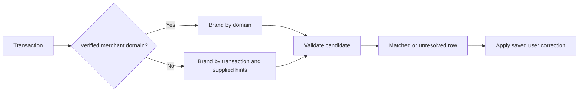

# Build a recognizable merchant feed

> Turn merchant domains or transaction descriptors into readable transaction rows while preserving unresolved states and user corrections.

```text Recipe prompt theme={null}
Implement this recipe in my project:
https://docs.context.dev/use-cases/merchant-transaction-feeds.md

Read the recipe and linked API guides, inspect this project's stack, and build the complete flow using its existing conventions.

Build transaction rows with merchant names and logos while preserving the original descriptor. Use Brand by domain when a verified domain is available, otherwise use transaction lookup with only the supplied hints. Include all matching hints in the cache key, expose unresolved and failed states, and preserve user corrections across refreshes. Do not invent confidence scores.

Reuse existing Context.dev configuration and keep secret API keys on the server. If Context.dev is not set up yet, follow https://docs.context.dev/agent-quickstart.md first. Add focused tests, run the relevant checks, and document setup and how to try the result.
```

Show a merchant name and logo next to a transaction while keeping the original statement descriptor available. Context.dev supplies a candidate Brand profile; your application decides whether to accept the match and how to display it.

[Spendify uses Context.dev for merchant branding](https://www.context.dev/blog/spendify-ships-clean-merchant-branding-with-context-dev) after resolving merchant domains in its own pipeline. If your data starts with raw descriptors, use the transaction lookup branch below.

## Choose the lookup from the data you have



Use the [domain lookup guide](https://docs.context.dev/brand/lookup-by-domain.md) or the [transaction enrichment guide](https://docs.context.dev/brand/lookup-by-transaction.md) for complete requests in cURL and every SDK. Both use `POST /brand/retrieve` on your server with a secret API key from the [Quickstart](https://docs.context.dev/quickstart.md).

The following TypeScript adapter creates the request and an application cache key. Pass `request` as the body of the lookup. Only send hints that came from your payment processor or another verified source.

```typescript merchant-input.ts theme={null}
import { createHash } from "node:crypto";

type Transaction = {
  id: string;
  rawDescriptor: string;
  merchantDomain?: string;
  mcc?: string;
  country?: string;
  city?: string;
  phone?: string;
};

export function merchantLookup(tenantId: string, transaction: Transaction) {
  const domain = transaction.merchantDomain?.trim().toLowerCase();
  const request = domain
    ? { type: "by_domain" as const, domain }
    : {
        type: "by_transaction" as const,
        transaction_info: transaction.rawDescriptor,
        mcc: transaction.mcc,
        country_gl: transaction.country,
        city: transaction.city,
        phone: transaction.phone,
        high_confidence_only: true,
      };

  const normalize = (value?: string) => value?.trim().replace(/\s+/g, " ").toLowerCase() ?? null;
  const inputs = domain
    ? ["domain", domain]
    : ["transaction", normalize(transaction.rawDescriptor), transaction.mcc ?? null,
       normalize(transaction.country), normalize(transaction.city),
       normalize(transaction.phone), request.high_confidence_only];
  const cacheKey = createHash("sha256")
    .update(JSON.stringify([tenantId, ...inputs]))
    .digest("hex");

  return { request, cacheKey };
}
```

Validate the input before queuing it. `transaction_info` accepts 3 to 500 characters. Keep its original value in the request and ledger; normalization above is only for cache identity. Include every hint that can change the match, and scope the cache to your application's account boundary.

## Preserve the lookup outcome

Treat these states separately in your worker:

| Result | Save | Next action |
| - | - | - |
| Profile accepted after checking available context | `matched`, candidate profile, lookup time, input key | Render the candidate. |
| No profile or an ambiguous candidate | `unresolved`, original descriptor | Show a neutral row and allow correction. |
| Network failure, `408`, `429`, or server error | `retryable_error`, last attempt time | Retry with bounded backoff and honor `Retry-After`. |
| Invalid input or authentication error | `error`, diagnostic code | Correct the input or integration before retrying. |

An HTTP success does not establish that the candidate is the right local merchant. Compare the domain and title with the available context, especially for payment processors, franchises, and parent brands. Keep a review state when your application cannot make that decision.

The Brand response has no public numeric confidence score. `high_confidence_only` is a request mode; do not turn it into a displayed percentage. Brand enrichment also does not provide a fraud verdict or legal-entity verification.

## Render the row with corrections first

Store corrections separately from cached API results. The following view model uses the correction whenever one exists, including after a failed refresh. `logoUrl: null` is an explicit choice to use no logo.

```typescript merchant-view.ts theme={null}
type Merchant = { name: string; domain: string | null; logoUrl: string | null };
type Lookup =
  | { status: "matched"; merchant: Merchant; retrievedAt: string }
  | { status: "unresolved" | "retryable_error" | "error"; attemptedAt: string };
type Correction = {
  merchant: Merchant;
  editedAt: string;
  editedBy: string;
};

export function transactionView(
  transaction: { id: string; rawDescriptor: string },
  lookup: Lookup,
  correction: Correction | null,
) {
  const merchant = correction?.merchant ??
    (lookup.status === "matched" ? lookup.merchant : null);

  return {
    transactionId: transaction.id,
    originalDescriptor: transaction.rawDescriptor,
    name: merchant?.name ?? transaction.rawDescriptor,
    domain: merchant?.domain ?? null,
    logoUrl: merchant?.logoUrl ?? null,
    source: correction ? "user" : merchant ? "context" : "statement",
    status: correction ? "corrected" : lookup.status,
  };
}
```

Display `originalDescriptor` in the transaction details. Use a fixed image box and a neutral fallback when a logo is missing or fails to load. Keep the amount, currency, booking date, and processor category from your ledger; a Brand profile should not overwrite those fields.

If a correction should apply to future transactions, ask the user to choose its scope and save a separate merchant rule. Do not silently apply a correction for one transaction to every similar descriptor.

## Refresh without losing decisions

Cache accepted candidates with the matching input key and retrieval time. Give unresolved results a shorter retry window; do not cache a temporary failure as a permanent miss. On refresh, replace only the automatic result, then apply the saved correction again.

A useful feed test includes four rows: a known merchant domain, a descriptor with supplied location hints, an unresolved descriptor, and a manually corrected merchant. Replay enrichment after a temporary failure and verify that the corrected row and original ledger data remain intact.

> [card] [Transaction lookup](https://docs.context.dev/brand/lookup-by-transaction.md)
>
> Send descriptors and optional matching hints.

> [card] [Company directory logos](https://docs.context.dev/use-cases/company-directory-logos.md)
>
> Add accessible image fallbacks and editable branding.


This documentation is built and hosted on [Mintlify](https://mintlify.com), a developer documentation platform.