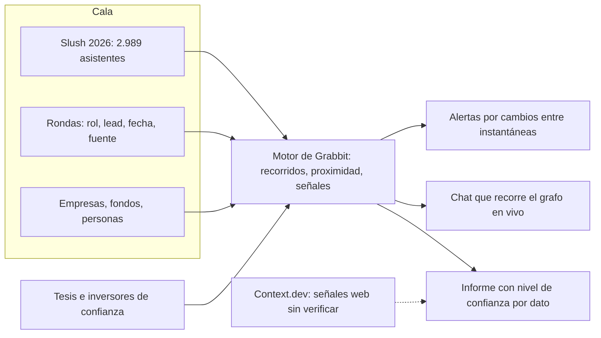

# Valoración de Cala como plataforma

Fecha: domingo 15 de noviembre de 2026 (Junction 2026, Espoo).
Base: lo que Grabbit ha construido sobre Cala entre el 13 y el 15 de noviembre. Fuentes al
final; cada cifra sale de ellas o de una medición propia. Las mediciones del 15 de noviembre
se hicieron sobre la caché real de respuestas de Cala: 1.145 respuestas, entre ellas 484
rondas, 226 empresas con propiedades y los 2.989 asistentes de Slush.

## Resumen y veredicto

Cala es el núcleo de Grabbit. Es la única fuente que responde a la pregunta del producto,
*¿qué startups de Slush están a pocas rondas de los inversores en los que confío?*, y cada
dato llega con su fuente. Sin Cala no habría producto, solo una búsqueda web sin garantías.

Como **dato**, Cala es fuerte. Da las rondas con el rol de cada participante y quién lideró,
una fuente y un nivel de confianza (`source_rank`) por hecho, y la lista de asistentes de
Slush enlazada al grafo. Como **plataforma**, todavía es inmadura para un producto en tiempo
real. Se lee nodo a nodo, sin filtros en el servidor y con latencias de minutos en nodos
grandes.

En cifras: con Y Combinator y 500 Global como inversores de confianza, el grafo de Cala
pasó a mostrar **27 startups de Slush** con uno de ellos en sus rondas (antes 5) y 8 de las
10 primeras del ranking eran invisibles antes. A cambio, un solo turno del chat hace **898
llamadas** a Cala (casi todas desde la caché) y leer Slush entero costaría unas **9.000**.

Veredicto: **la apuesta es correcta para el papel de fuente verificada**, siempre que el
producto gestione por su cuenta la caché, el número de llamadas y la identidad de las
entidades. Buena parte de nuestra ingeniería se ha ido a eso y no a la lógica de negocio.

## Qué es Cala y qué le pedimos

Cala es un grafo de entidades (empresas, personas, inversores, rondas, eventos) con sus
relaciones, donde cada propiedad y cada arista llevan sus fuentes. Usamos cuatro llamadas:

| Paso | Endpoint | Para qué lo usamos |
| --- | --- | --- |
| Nombre a id | `GET /v1/entities?name=` | Encontrar todas las entidades de un fondo de confianza |
| Qué tiene un nodo | `GET /v1/entities/{id}/introspection` | Pedir solo los campos y aristas que existen |
| Leer un nodo y sus vecinos | `POST /v1/entities/{id}` | Asistentes del evento, empresas, rondas, inversores |
| Noticias (LLM) | `POST /v1/knowledge/query` | Solo "latest news regarding X", por consejo de Cala |

Tres nodos y una arista sostienen todo el motor:

```
Inversor --PARTICIPATES_IN_FUNDING_ROUND--> Ronda <--PARTICIPATES_IN_FUNDING_ROUND-- Empresa
          rol INVESTOR | LENDER | GRANTOR, is_lead              rol ISSUER
Empresa --PARTICIPATES_IN_EVENT (ATTENDEE)--> Slush 2026
```

Cala nos pidió construir sobre los endpoints de entidades, que devuelven el grafo en
bruto, y no sobre `knowledge/search` y `knowledge/query`, que pasan por un LLM, pierden
información y van a desaparecer. La única excepción son las noticias.

## Cómo lo hemos usado: recorrido y evolución

La solución pasó de "leer el evento" a "recorrer el grafo desde la confianza del inversor".
Cada paso respondió a algo que aprendimos de Cala.

| Cuándo | Qué hicimos | Qué de Cala lo motivó |
| --- | --- | --- |
| 13 nov, 22:30 | Cala como fuente verificada, la web solo como señal sin verificar | Cala valora la veracidad del dato |
| 13 nov, 22:30 | Grafo en bruto, no endpoints con LLM | Petición del equipo de Cala |
| 14 nov, 02:45–03:10 | Persona: business angel en Slush. El evento `Slush 2026` como lista de partida | La guía de campos muestra ese camino |
| 14 nov, 03:10 | "Co-invierte con quien confías" y un nivel de confianza en cada dato | Solo el grafo de rondas responde a eso; `source_rank` lo hace posible |
| 14 nov, 09:40 | Primeros 150 de 2.989 asistentes, cacheados para la demo | Leer el evento entero cuesta miles de llamadas en serie |
| 14 nov, 11:40 | Noticias por startup con `knowledge/query` | Recomendación del taller de Cala |
| 14 nov, 11:50 | El chat recorre el grafo él mismo (buscar y abrir vecinos) | No hay consultas por criterios: hay que caminar |
| 14 nov, 17:30 | Enlaces ocultos de segundo grado entre startups e inversores | Las rondas enlazan a todos sus participantes |
| 14 nov, 17:40 | Caché compartida en Valkey para todas las instancias | Lecturas lentas: la demo tiene que responder sin esperar a Cala |
| 14 nov, 23:20 | Recorrido inverso: del inversor de confianza a sus rondas y a sus participadas en Slush | El recorrido por evento solo veía el 5 % de Slush |
| 14 nov, 23:27 | Segundo anillo: los co-inversores habituales de esos fondos | Las rondas leídas ya dicen quién invierte junto a quién |
| 14 nov, 23:20–23:50 | Puntuación de proximidad e identidad de fondo por nombre | Un fondo real son muchas entidades en Cala |
| 15 nov | Correcciones del motor (#205) y auditoría de datos | Revisión con datos reales de Cala |

El cambio de fondo fue el recorrido inverso. Antes se leían los asistentes en el orden de
Cala y la confianza del inversor solo etiquetaba el resultado. Ahora decide qué se lee:
de 5 a 27 startups con un inversor de confianza en sus rondas, y de 5 a 45 con algún camino
hacia uno, con Y Combinator y 500 Global ([algorithm.md](../algorithm.md), "Results").

## Por qué es importante

Cala ocupa el centro de la solución. Todo lo que el usuario ve sale del grafo o se apoya en él:



- **Responde a la pregunta que nadie más responde.** Qué fondos de confianza han invertido
  en qué asistentes, y a cuántas rondas de distancia, solo sale del grafo de rondas. Una
  búsqueda web no da ni los participantes por ronda ni quién lideró. En Cala, el 79 % de
  las rondas leídas tiene un lead identificado.
- **Encuentra lo que una persona no puede revisar.** De las 165 rondas de Y Combinator,
  100 participadas distintas entre las 150 primeras leídas, 20 están en Slush. Una de cada
  cuatro participadas de YC y 500 Global va al evento.
- **Hace creíble cada dato.** El nivel de fuente (registro, empresa o inversor, prensa,
  agregador) se convierte en una etiqueta junto a cada valor. Es nuestro diferenciador
  principal frente a bases de datos con alertas. El 75 % de las fuentes de propiedades
  tiene un rango de registro, empresa o prensa; solo el 13 % viene de agregadores.
- **Hace explicable el ranking.** Cada camino de la puntuación son aristas reales de Cala
  con sus fuentes; la tarjeta dibuja "por qué está aquí". Cada candidata muestra como
  máximo 5 caminos y su puntuación es exactamente su suma.
- **Es un criterio del jurado.** "Use of Cala" vale el 25 % de la nota del reto: Cala tiene
  que ser el núcleo y no un añadido ([challenge.md](../agents/challenge.md)).

## Ventajas clave

| Ventaja | Qué nos permitió | Evidencia |
| --- | --- | --- |
| Rondas con participantes, rol y `is_lead` | Co-inversión, proximidad, señal de seguimiento del lead | De 484 rondas: 93 % con financiadores, 79 % con lead, 94 % con fecha, 77 % con importe; mediana de 2 financiadores, máximo 32 |
| Fuentes por hecho con `source_rank` y precisión de fecha | Etiquetas de confianza; "2019" en vez de una fecha inventada | 8.033 fuentes de propiedades: 36 % empresa o inversor, 26 % prensa, 13 % registro oficial, 13 % agregador, 11 % sin rango, 1 % vacías |
| Eventos como lista de entidades | Partir de los 2.989 asistentes reales de Slush | 30 páginas de 100; 2.980 son `Company`, 8 `Organization`, 1 institución educativa |
| Introspección por entidad | Preguntar solo por campos que existen; el producto mejora solo cuando crece la cobertura | Decisión 2026-11-14 01:35 |
| Grafo enlazado de punta a punta | Recorrido inverso y segundo anillo sin otra fuente | Desde 2 fondos: 274 rondas, 184 participadas distintas, 42 en Slush, 40 startups; 373 co-inversores vistos |
| Ausente no es cero | "No publicado" en vez de un cero falso | Un cero confirmado viene como `0` con fuente; un campo ausente simplemente no aparece |
| Registros oficiales en algunos países | Cuentas y propietarios en Reino Unido, cuenta de resultados en Francia | research.md, "Cala coverage" |
| API y MCP con los mismos verbos | El chat camina el grafo con dos herramientas | `cala_search`, `cala_neighbours` |
| Equipo de Cala accesible | Guía de campos, taller y respuestas en el evento | Noticias por consejo del taller |

## Limitaciones encontradas

Esta es la parte más importante: son las que han marcado el diseño. Las agrupamos por tipo.

### Acceso y forma de la API

| Limitación | Evidencia | Impacto en Grabbit |
| --- | --- | --- |
| No hay llamada que devuelva un subgrafo ni que liste entidades por criterios | Un nodo por llamada; sin filtros ni orden en el servidor | Filtrar, ordenar y puntuar es todo local; el primer turno del chat hace 898 llamadas |
| Leer el evento entero no es asumible | Unas 3 llamadas por asistente (456 para 150): unas 9.000 para Slush (estimación); 76 de los 150 primeros no eran startups | El recorrido por evento se limitó a 150 asistentes (5 %); hizo falta inventar el recorrido inverso |
| La arista inversor → ronda no lleva fecha | Lo reciente solo se sabe tras leer la ronda | Las rondas se leen en el orden de Cala; si el recorrido se corta antes, se pueden haber leído primero las viejas |
| Sin filtros en aristas | No se puede pedir "las rondas de este fondo desde 2024" | Se pagina todo y se descarta en local |
| Tamaño máximo de página sin documentar | `limit: 100` funciona; máximo y defecto sin medir | Paginamos de 100 en 100 por prudencia |
| Sin push ni webhooks | Ningún mecanismo de cambios | Alertas por sondeo y comparación de instantáneas |
| Los endpoints con LLM pierden datos y se retiran | Petición de Cala; respuestas aproximadas ("over 100M") | No sirven para descubrir; solo los usamos para noticias |

### Rendimiento y volumen de llamadas

| Limitación | Evidencia | Impacto en Grabbit |
| --- | --- | --- |
| Caídas con 403 en HTML | Varios minutos el 14 nov hacia las 11:40, incluso con una sola petición | Se trata como "Cala no disponible" y se sirve desde la caché |
| Latencia muy variable | Normal < 1 s; introspección 4–11 s; una ronda de 15 participantes 12 s; dos lecturas de unos 7 minutos | Tiempo máximo de 25 s por llamada; la demo depende de una caché precalentada |
| Nodos hub impracticables | Las aristas de un nodo `Industry` no respondieron en 50 s | Nunca se expanden industrias, países ni eventos en el chat; tope de 300 rondas por co-inversor |
| Noticias lentas e inestables | 29–46 s por llamada (hasta 180 s documentado); a veces devuelve un perfil o nada | Solo en un proceso programado; los informes leen la caché |
| Mucho volumen en frío | Unas 520 lecturas en serie para dos inversores nuevos; un turno lee como máximo 300 nuevas para no hacer esperar | El primer turno con inversores nuevos sale parcial; la demo depende de `make warm` |

### Calidad e identidad de los datos

| Limitación | Evidencia | Impacto en Grabbit |
| --- | --- | --- |
| Un fondo real son muchas entidades | Y Combinator: 10 resultados de búsqueda (Company, Organization, Group, "Y Combinator W24"…), la mayoría sin rondas; 36 entidades entre YC y 500 Global | Regla de identidad por nombre (`Trusted`) en señales, informe, alertas y puntuación |
| Entidades duplicadas | Una persona como 3 nodos `Person`, Nvidia como 2 empresas, un fondo como Organization y Company | Deduplicación por nombre normalizado, web e id de registro |
| `INVESTED_IN` con la dirección cambiada | Mistral AI aparecía invirtiendo en sus propios inversores | Se ignora esa arista; solo cuentan los participantes de las rondas |
| Rol `GRANTOR` no documentado | 70 grantors en 108 rondas, casi todos agencias públicas (Innovate UK 20, Business Finland 11) | Fuera de la lista de inversores; solo cuenta si el grantor es un fondo de confianza |
| Fundadores sin historial | De 40 fundadores y CEOs probados, ninguno enlazaba con otra empresa | Se descartó la señal de "fundador recurrente" |
| Inversores pequeños con pocas aristas | Pioneer Fund: 1 ronda como inversor, 16 como co-inversor de YC | Esos fondos aportan poco como inversor de confianza |
| Campos muy incompletos | De 226 empresas leídas: etapa 25 %, plantilla 17 %, financiación total 29 %, fecha de fundación 65 %, web 82 %. De 81 candidatas: 33 % sin etapa, 62 % sin plantilla; 92 de sus 171 rondas (54 %) sin inversores listados | El filtro de etapa y el anillo 1 no las ven; las rondas sin fecha cuentan a la mitad |
| Empresas maduras entre los asistentes | D-ID (Serie B), Helion Energy (Serie G), ElevenLabs y Modal Labs (Serie D) pasan las reglas de startup | Hace falta un filtro de etapa en el perfil |
| Dos modelos de ronda | `FundingRound` (anuncios) y `PrivateCompanyFundingRound` (registros) pueden repetir la misma financiación | Se cruzan por fecha e importe antes de sumar |
| Industrias poco fiables | `AEROSPACE_AND_DEFENSE` en una startup de LLM | No se usan para "empresas parecidas" |
| Fuentes vacías o sin rango | 11 % de las fuentes de propiedades y 12 % de las de aristas de ronda sin `source_rank`; 53 propiedades con `sources: []` | Se tratan como agregador, el nivel más bajo |
| Cobertura desigual por país | Reino Unido y Francia con registros; España y Finlandia solo datos básicos | La demo elige empresas con datos |

## Cómo las sorteamos en el diseño

| Problema | Solución en Grabbit | Dónde |
| --- | --- | --- |
| Latencia y caídas | Caché de cada respuesta (SQLite y Valkey compartido), modo replay y `make warm --check` antes de la demo | `app/cala/client.py`, `app/store/` |
| Nodos lentos | Tiempo máximo de 25 s por llamada y como máximo 300 lecturas nuevas por recorrido, para acotar la espera | `ReverseLimits`, `LinkLimits` |
| Sin consultas por criterios | Búsqueda de encuentro a medio camino: del fondo a sus rondas, cruzado con los asistentes | `discovery/reverse.py` |
| Un fondo, muchas entidades | Coincidencia por id o por nombre de fondo en todo el producto | `app/trusted.py` |
| Errores repetidos | Los 404 también se cachean; los demás errores no | `app/cala/client.py` |
| Sin webhooks | Rutinas programadas que comparan instantáneas | `app/watcher/` |
| Confianza variable | `source_rank` como etiqueta en cada dato; lo ausente es "no publicado" | `app/cala/normalize.py` |
| Noticias lentas | Solo en un proceso programado; los informes leen la caché | `app/cala/news.py` |

## Recomendaciones y peticiones a Cala

Ordenadas por impacto en un producto como Grabbit:

1. **Leer varios nodos en una llamada**, o un subgrafo a profundidad 2. Hoy un informe son
   cientos de llamadas en serie.
2. **Fecha y filtros en las aristas**: la fecha de la ronda en la arista inversor → ronda y
   poder pedir "desde una fecha", para leer primero lo reciente.
3. **Identidad canónica de fondo**: un id de familia que agrupe Company, Organization y
   vehículos ("Y Combinator W24").
4. **Corregir la dirección de `INVESTED_IN`** y documentar el rol `GRANTOR`.
5. **Un feed de cambios o webhooks**, para alertas sin sondeo.
6. **Más cobertura de etapa, plantilla y participantes de ronda** en startups pequeñas.
7. **Latencia acotada en nodos hub** o una forma paginada de recorrerlos.

## Fuentes

- [docs/agents/cala.md](../agents/cala.md): endpoints, peculiaridades de los datos y
  latencias medidas (13–14 nov).
- [docs/agents/decisions.md](../agents/decisions.md): decisiones fechadas que marcan la evolución.
- [docs/algorithm.md](../algorithm.md): el motor, sus resultados, la revisión del 15 nov y la
  auditoría de datos.
- [docs/agents/research.md](../agents/research.md), "Cala coverage": cobertura por país.
- [docs/agents/challenge.md](../agents/challenge.md): el reto y los criterios del jurado.
- [docs/research/acta-2026-11-13.md](acta-2026-11-13.md): validación de la idea con inversores.
